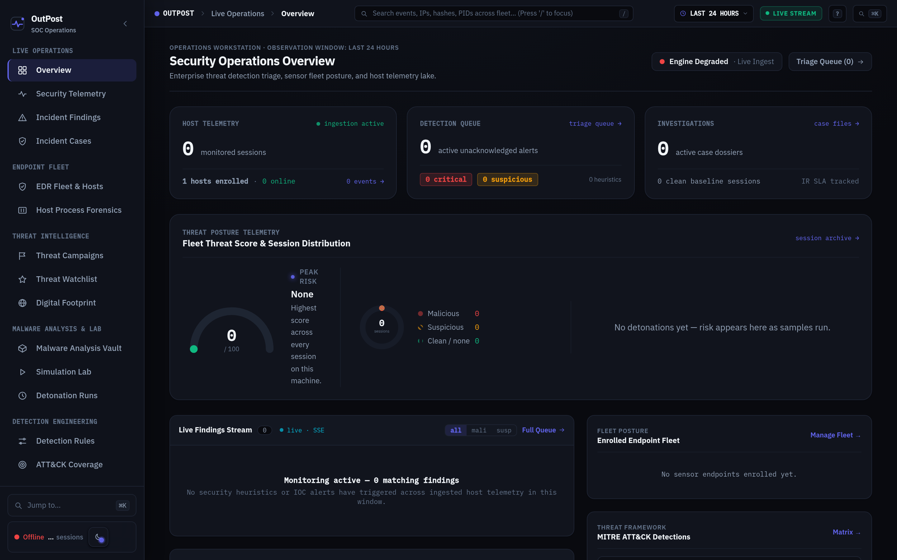
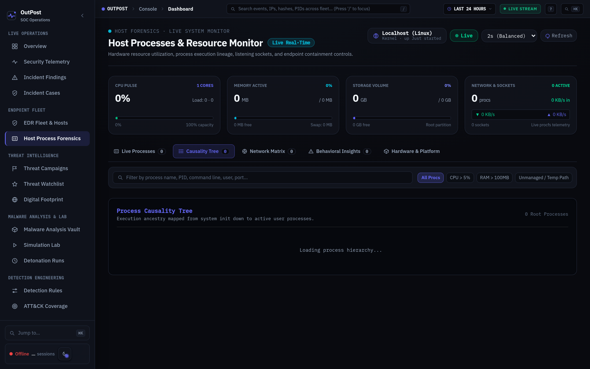

# OutPost

[](https://github.com/kripy17/OutPost/actions/workflows/ci.yml)
[](LICENSE)

Offline-first workbench for triaging Linux and Windows host telemetry and analyzing suspicious files.

Status: Experimental. Single-author project. Last verified: October 2026. 1,706 automated tests passing.


*Figure 1: OutPost investigation console populated with multi-host seeded demo telemetry (October 2026).*

---

## What It Does

OutPost collects host events (`auditd` and ftrace on Linux, Sysmon on Windows), evaluates 48 behavioral heuristics and a Sigma rule evaluator, supports host triage, cases, and forensic exports, and provides static analysis and an unshared-namespace dynamic sandbox for suspicious files. Both a local web console and a terminal user interface (TUI) are provided for analyst inspection on a single node without external cloud dependencies.

---

## What It Is Not

- **Not an EDR**: OutPost does not provide continuous automated kernel-level prevention or distributed fleet management across thousands of corporate endpoints.
- **Not an Enterprise SIEM**: OutPost does not offer multi-terabyte distributed indexing, cloud data lakes, or cross-log correlation for arbitrary SaaS applications.
- **Not a Hosted Sandbox Service**: OutPost does not run full virtualized Windows operating systems with kernel hypervisors; dynamic execution relies on Linux user namespaces (Bubblewrap) and user-mode Wine emulation.
- **Not for Fleet Management**: OutPost is architected for triaging lab runs, local host incidents, and environments of up to a few dozen endpoints on a single workstation or analysis virtual machine.

---

## Capability Matrix

| Capability | Linux | Windows | macOS |
|---|---|---|---|
| **Host Telemetry Collection** | Supported | Supported | Partial [1] |
| **Behavioral Detection Rules** | Supported | Supported | Partial [2] |
| **Sigma Rule Evaluation** | Supported | Supported | Supported |
| **YARA Signature Scanning** | Supported [3] | Supported [3] | Supported [3] |
| **Static Binary Analysis** | Supported | Supported | Partial [4] |
| **Dynamic Sandbox Analysis** | Supported [5] | Experimental [6] | Not Supported [7] |
| **Forensic Host Triage** | Supported | Partial [8] | Partial [9] |
| **Endpoint Containment** | Supported [10] | Partial [11] | Partial [12] |
| **Case Management & Playbooks** | Supported | Supported | Supported |
| **Forensic Export & Reporting** | Supported | Supported | Supported |
| **CLI & Terminal UI (TUI)** | Supported | Supported [13] | Supported |

### Capability Footnotes
- **[1] macOS Telemetry**: The collector uses `psutil` userland process polling and connection diffing (2-second interval). It does not interface directly with the Apple EndpointSecurity C API; short-lived processes (<2s) can be missed.
- **[2] macOS Detection**: 48 behavioral rules evaluate across all platforms; specific macOS behavioral coverage is limited to 4 rules (TCC bypass, LaunchAgent persistence, Gatekeeper bypass, dylib hijacking).
- **[3] YARA Scanning**: Requires optional `yara-python` package. If absent, engine falls back to ASCII/Unicode string extraction and entropy analysis.
- **[4] macOS Static Analysis**: Mach-O header parsing is basic compared to PE and ELF format decoders.
- **[5] Linux Dynamic Sandbox**: Uses Bubblewrap (`bwrap`) with unshared PID, IPC, UTS, and network namespaces (`--unshare-net`). Requires host kernel support for unprivileged user namespaces.
- **[6] Windows Dynamic Sandbox**: Executes Windows PE binaries inside a Wine64 translation layer confined within Bubblewrap on a Linux host. Cannot execute kernel-mode drivers or proprietary Windows subsystems.
- **[7] macOS Dynamic Sandbox**: Bubblewrap relies on Linux kernel namespaces and is unavailable on macOS.
- **[8] Windows Forensic Triage**: Reads active processes and sockets via `psutil` and tasklist; memory dump analysis requires external Volatility 3 installation.
- **[9] macOS Forensic Triage**: Process and open socket enumeration via `psutil`; package inventory checks via Homebrew.
- **[10] Linux Containment**: Enforces network isolation via host `iptables`/`nftables` rules; process termination supports start-time verification. Requires elevated root privileges.
- **[11] Windows Containment**: Process suspension and termination via Win32 API; network isolation via Windows Firewall script.
- **[12] macOS Containment**: Process termination via POSIX signals; network isolation via packet filter (`pfctl`).
- **[13] Windows TUI**: Full-screen TUI requires a terminal emulator with ANSI color and UTF-8 support (such as Windows Terminal).

---

## Static Analysis Format Support

Untrusted binaries are analyzed in an isolated subprocess (`backend/app/services/static/worker.py`) constrained by OS resource limits (`RLIMIT_CPU`, `RLIMIT_AS` on Linux).

| Format | What Is Extracted | Known Unsupported Variants | Automated Test |
|---|---|---|---|
| **PE (Windows Executable)** | Headers, sections (entropy, permissions), imports/IAT, exports, Authenticode security directory bytes & certificate serial [1], imphash, debug info, overlay | Corrupted DOS stubs with out-of-bounds PE headers; .NET CLR metadata deep decompilation | [`test_pe_analysis_format_extraction`](backend/app/tests/test_multiformat_static_analysis.py) |
| **ELF (Linux Binary)** | Headers (32/64-bit, endianness), program segments, section headers, dynamic symbols, imported shared libraries (`DT_NEEDED`), entry point | Non-standard architectures; packed binaries without prior unpacking | [`test_elf_analysis_format_extraction`](backend/app/tests/test_multiformat_static_analysis.py) |
| **Archives & ISO** | ZIP/TAR member names, compressed/uncompressed sizes, zip bomb ratio ceiling (>100:1 / 100MB max) [2], ISO9660 volume descriptors & directory walk | UDF (Universal Disk Format) ISOs; password-encrypted archives; 7z/RAR formats | [`test_archive_zip_bomb_safety_guard`](backend/app/tests/test_multiformat_static_analysis.py) |
| **Office Documents** | OLE structured storage streams, VBA macro presence (AutoOpen/Workbook_Open strings), OOXML XML parts, external template injection URLs | Password-protected or encrypted Office documents; legacy Word 6.0/95 binary formats | [`test_office_macro_and_template_detection`](backend/app/tests/test_multiformat_static_analysis.py) |
| **PDF Documents** | Dictionary elements, page count, `/JavaScript`, `/JS`, `/OpenAction`, `/AA`, `/EmbeddedFiles`, `/Launch` action streams | AES/RC4 password-encrypted PDFs; XFA dynamic script forms | [`test_pdf_openaction_and_javascript`](backend/app/tests/test_multiformat_static_analysis.py) |
| **Windows Shortcuts (LNK)** | Shell link header, CLSID, LinkFlags, LocalBasePath target, command-line arguments, icon location, show window flags | Corrupted extra data blocks | [`test_lnk_stealth_sw_hide_and_lolbin`](backend/app/tests/test_multiformat_static_analysis.py) |
| **Scripts (PS1, Bash, Py, Bat)** | Language identification, base64 encoded payload decompression, obfuscated invocation patterns (`-enc`, `iex`, `downloadstring`) | Proprietary tokenized script formats; polymorphic runtime decrypters | [`test_script_layered_deobfuscation`](backend/app/tests/test_multiformat_static_analysis.py) |
| **Family Config Decoders** | AgentTesla (SMTP/FTP/HTTP C2 config extraction), Cobalt Strike (standard XOR 0x2e / 0x69 beacon configuration blocks) | Non-standard salt XOR/AES keys; variants using external stage-two downloaders | [`test_family_config_decoder_agent_tesla`](backend/app/tests/test_multiformat_static_analysis.py) |

- **[1] Authenticode Verification Limit**: Certificate structures and serials are parsed directly from the binary security directory. Offline trust chain validation against root certificate authorities is not performed without a configured local root trust store.
- **[2] Decompression Limits**: Ingested archives and HTTP request payloads enforce an upper ceiling of 50 MB compressed and a 100:1 decompression ratio limit to abort zip bombs.

### Verdict Vocabulary
The static analysis engine classifies samples into four explicit verdicts defined in [`backend/app/services/static/verdict.py`](backend/app/services/static/verdict.py):
- `malicious`: Triggered when weighted evidence score >= 60 (or any high-confidence threat indicator with weight >= 30, such as verified C2 endpoints, process injection imports, or ransomware crypto APIs) and net score >= 35 after subtracting benign mitigations.
- `suspicious`: Triggered when net score >= 25 or at least 2 anomalous factors are present (such as high entropy with overlay, hidden window flags, suspicious API imports, or anomalous section headers).
- `no_indicators_found_limited`: Triggered when zero threat indicators or structural anomalies are detected within the parsed layers. Indicates that no indicators were discovered within the tool's parsing boundaries, without claiming the file is benign.
- `insufficient_evidence`: Triggered when minor non-conclusive signals are observed that do not reach the threshold for suspicious, or where parsing was partially obstructed.

---

## Quick Start

### Prerequisites
- **Python**: Version 3.10 to 3.14 (3.12 recommended).
- **Node.js**: Version 18.0 or newer (tested on Node 22).
- **SQLite**: Version 3.35 or newer (bundled with modern Python distributions).

### Optional Dependencies & Degradation
- `bubblewrap` (`bwrap`): For local sandbox execution. If absent, dynamic analysis is disabled.
- `wine64`: For Windows PE execution inside Linux sandboxes. If absent, dynamic Windows detonation fails closed.
- `yara-python`: For compiling and scanning custom YARA rules. If absent, engine falls back to ASCII/Unicode string matching and entropy extraction.
- `flare-capa` (`capa`): For automated capability identification in PE files. If absent, capability mapping falls back to built-in string and API import pattern matching.
- `postgresql` (`psycopg` via `backend[pg]`): Optional database backend. If absent, SQLite is used automatically.

### Platform Support
- **Server**: Runs on Linux (x86_64, aarch64) or Windows via WSL2.
- **Collectors**: Linux collector runs natively on Linux (Python 3.8+, auditd); Windows collector runs natively on Windows (PowerShell 5.1+, Sysmon); macOS collector runs natively on macOS (Python 3.8+).

### Installation and Launch
Clone the repository and run the setup script (takes approximately 1 to 2 minutes on a clean environment):

```bash
git clone https://github.com/kripy17/OutPost.git
cd OutPost
./setup.sh
```

Launch the platform with the bundled demo dataset:

```bash
./outpost.sh start --demo
```

### Expected Output
```text
==========================================
      OutPost Security Monitor
==========================================
[*] Backend API:  http://localhost:8001
[*] Web Console:  http://localhost:5174
==========================================
[*] Initializing database with demo telemetry...
[*] Starting FastAPI Backend on port 8001...
[*] Starting Frontend Web Console on port 5174...
==========================================
 [✓] OutPost is running live!
 Web Console: http://localhost:5174
 API Docs:    http://localhost:8001/docs
 Press Ctrl+C in this terminal to stop.
==========================================
```

### Verification
1. Open `http://localhost:5174` in your browser. The console displays 4 endpoints, active investigation cases, and behavioral alerts.
2. Query the backend health endpoint from a terminal:
   ```bash
   curl -s http://127.0.0.1:8001/health
   ```
   Expected response:
   ```json
   {"status":"healthy","database":"sqlite","version":"0.3.1"}
   ```
3. Run the interactive terminal interface:
   ```bash
   ./outpost.sh tui
   ```

### Bundled Demo Dataset Details
The `--demo` flag populates the database using [`backend/app/seed_demo.py`](backend/app/seed_demo.py). It contains simulated telemetry representing 4 distinct endpoints (`dc01.corp.internal`, `web01.dmz.internal`, `mac-analyst-01`, and `db01.prod.internal`), including process executions, network connections, 6 correlated behavioral alerts, and 2 investigation cases. Total seeded database size is under 2 MB. Licensed under the MIT License.

---

## Offline Installation

OutPost supports environments without direct internet access.

1. **Vendor Python Wheels**: On an internet-connected machine with identical OS and Python versions:
   ```bash
   pip wheel -r backend/requirements.txt -w ./wheelhouse
   pip wheel -r cli/requirements.txt -w ./wheelhouse
   ```
2. **Build Static Frontend**: Compile the web console to production assets:
   ```bash
   cd frontend && npm ci && npm run build
   ```
3. **Archive and Transfer**: Copy the repository, `./wheelhouse`, and `frontend/dist` to the target air-gapped machine.
4. **Install Offline**:
   ```bash
   python3 -m venv .venv
   source .venv/bin/activate
   pip install --no-index --find-links=./wheelhouse -e "./backend" -e "./cli"
   ```

---

## Deploying Collectors

OutPost collectors are standalone Python scripts that gather host events, normalize them into the unified schema, and ship them via HTTP POST to the backend ingest API.

```
+-----------------------------------------------------------------------------+
|                               SECURITY WARNING                              |
| Do not pipe unauthenticated remote scripts into an elevated shell (e.g.     |
| curl http://server/install.sh | sudo bash). Always download the script,      |
| inspect its contents, and verify checksums before elevated execution.       |
+-----------------------------------------------------------------------------+
```

### Linux Collector Setup
Requires Python 3.8+ and `auditd`. Needs root privileges to configure audit rules and read `/var/log/audit/audit.log`.

1. Download and inspect the install script:
   ```bash
   curl -sSL -O http://<OUTPOST_SERVER>:8001/agents/install.sh
   bash install.sh --dry-run
   ```
2. Install the agent service with an enrollment token:
   ```bash
   sudo bash install.sh --server http://<OUTPOST_SERVER>:8001 --token <ENROLLMENT_TOKEN>
   ```
3. Privilege boundaries:
   - **With root**: Loads kernel audit rules via `auditctl -R`, reads audit netlink logs, reads `/proc/{pid}/cmdline`, and enforces network isolation via packet filters.
   - **Without root**: Collector cannot access auditd logs; restricted to monitoring unprivileged simulated log files.

### Windows Collector Setup
Requires Windows 10/11 or Server 2016+, PowerShell 5.1+, and Microsoft Sysmon. Needs Administrator privileges to query the Sysmon event log channel.

1. Download and inspect the PowerShell installer:
   ```powershell
   Invoke-WebRequest -Uri "http://<OUTPOST_SERVER>:8001/agents/install.ps1" -OutFile "install.ps1"
   Get-Content .\install.ps1 | Select-Object -First 50
   ```
2. Execute in an elevated PowerShell terminal:
   ```powershell
   # Note: -ExecutionPolicy Bypass is required only if local script execution is restricted by PowerShell policy
   powershell -ExecutionPolicy Bypass -File .\install.ps1 -DryRun
   powershell -ExecutionPolicy Bypass -File .\install.ps1 -Server "http://<OUTPOST_SERVER>:8001" -Token "<ENROLLMENT_TOKEN>"
   ```
3. Privilege boundaries:
   - **With Administrator**: Configures Sysmon service and tails the `Microsoft-Windows-Sysmon/Operational` event log channel.
   - **Without Administrator**: Cannot access the Sysmon event log; telemetry shipping fails.

---

## Architecture and Data Flow

```
                      +---------------------------------------+
                      |           Endpoint Hosts              |
                      |  Linux (auditd) · Windows (Sysmon)    |
                      +---------------------------------------+
                                          |
                                          v
                      +---------------------------------------+
                      |         Shipper & Local Spool         |
                      |     (In-Memory Buffer & Re-queue)     |
                      +---------------------------------------+
                                          |
                                          | Telemetry (HTTP POST /ingest/batch)
                                          v
+-----------------------------------------------------------------------------------+
| OutPost Backend Service (:8001)                                                   |
|                                                                                   |
|  +--------------------+      +--------------------+      +---------------------+  |
|  | Ingest API         | ---> | Schema Validator   | ---> | Database Layer      |  |
|  | (/ingest/batch)    |      | & Normalizer       |      | SQLite / PostgreSQL |  |
|  +--------------------+      +--------------------+      +---------------------+  |
|                                        |                            |             |
|                                        v                            v             |
|                              +--------------------+      +---------------------+  |
|                              | Detection Engine   | ---> | Alerts & Risk Score |  |
|                              | 48 Rules + Sigma   |      | Entity Correlation  |  |
|                              +--------------------+      +---------------------+  |
|                                                                     |             |
|  +--------------------+      +--------------------+                 |             |
|  | Control Channel    | <--- | Tamper-Evident     | <---------------+             |
|  | (Agent Heartbeats) |      | Audit Trail        |                               |
|  +--------------------+      +--------------------+                               |
|            |                           |                                          |
|            v                           v                                          |
|  +--------------------+      +--------------------+                               |
|  | Dynamic Sandbox    |      | Server-Sent Events |                               |
|  | Bubblewrap / Wine  |      | (/events/stream)   |                               |
|  +--------------------+      +--------------------+                               |
+----------------------------------------|------------------------------------------+
                                         |
                     +-------------------+-------------------+
                     |                                       |
                     v                                       v
         +-----------------------+               +-----------------------+
         | Frontend Web Console  |               | Terminal UI (TUI)     |
         | React 19 + TypeScript |               | Typer + Rich (CLI)    |
         | Port :5174            |               | Local Terminal        |
         +-----------------------+               +-----------------------+
```

### Data Flow
1. **Collection & Spooling**: Collectors read kernel and OS events, buffer events in memory, and dispatch batches to `POST /ingest/batch`.
2. **Ingest & Normalization**: The API parses batches into standard models (event timestamp, platform, process ID, executable path, command line, IP, port).
3. **Storage & Detection**: Events write to the relational store. In-process detection rules evaluate the batch immediately against existing process maps and baseline models.
4. **Correlation & Alerting**: Alerts are persisted with calculated risk scores (0–100) and broadcast to active consumers over SSE (`/events/stream`).
5. **Control Channel**: Agents poll the backend during 60-second heartbeat cycles (`POST /agents/{host_id}/heartbeat`) to retrieve pending operational actions (containment isolation or process termination).

### Storage Limits
- **SQLite (Default)**: Single-file database located at `backend/data/outpost.db`. Supports up to ~1,500 events per second before write serialization latency increases. Recommended for single-workstation analysis and homelabs.
- **PostgreSQL**: Configured via `OUTPOST_DATABASE_URL`. Offloads concurrency locking and scales to higher ingestion volumes across larger multi-host labs.

---

## Detection Engine

OutPost evaluates behavioral detection rules synchronously during event ingestion.


*Figure 2: Correlated parent-child process causality tree populated from multi-host attack simulation (October 2026).*

### Rule Organization
Rules are maintained across two subsystems:
1. **Behavioral Code Rules**: 48 active rule definitions defined in [`backend/app/services/risk.py`](backend/app/services/risk.py#L28) and evaluated in [`backend/app/services/detection.py`](backend/app/services/detection.py). Rules cover LOLBIN execution, process masquerading, credential dumping patterns, registry persistence, SUID execution, and lateral movement.
2. **Sigma Rule Engine**: Evaluates standard Sigma rule conditions across ingested event selections, supporting custom YAML rule definitions.

### Field Requirements per Telemetry Source
- `process_create`: Requires `timestamp`, `pid`, `ppid`, `process_name`, `command_line`, `exe_path`.
- `network_connection`: Requires `timestamp`, `pid`, `dest_ip`, `dest_port`, `protocol`.
- `file_write` / `file_rename`: Requires `timestamp`, `pid`, `file_path`.
- `registry_write`: Requires `timestamp`, `key`, `value_name`, `value_data`.

### MITRE ATT&CK Mapping
The 48 behavioral rules map to **14 out of 14 Enterprise Tactics** and cover **36 specific techniques** in the ATT&CK Matrix:


*Figure 3: Interactive MITRE ATT&CK matrix heatmap displaying tactic and technique coverage (October 2026).*

| Tactic | Mapped Rules | Representative Techniques |
|---|---|---|
| **Reconnaissance** | `network-scan` | T1595 (Active Scanning) |
| **Resource Development** | `toolchain-build` | T1587.001 (Compilers) |
| **Initial Access** | `document-dropper` | T1566.002 (Spearphishing Link) |
| **Execution** | `lolbin-abuse`, `gtfobins-suid-execution` | T1059 (Command & Scripting), T1204 (User Execution) |
| **Persistence** | `registry-persistence`, `scheduled-task`, `ssh-authorized-keys` | T1547 (Boot Autostart), T1053.005 (Scheduled Task) |
| **Privilege Escalation** | `suid-set`, `ifeo-persistence` | T1548.001 (Setuid/Setgid), T1546.012 (IFEO) |
| **Defense Evasion** | `masquerading`, `shell-history-wipe`, `log-clearing` | T1036.005 (Match Legitimate Name), T1070.003 (Clear History) |
| **Credential Access** | `credential-dump` | T1003.001 (LSASS Memory) |
| **Discovery** | `enumeration-burst` | T1082 (System Information Discovery) |
| **Lateral Movement** | `lateral-smb-share`, `lateral-winrm-wmi`, `lateral-psexec-smb` | T1021.002 (SMB/Windows Admin Shares), T1021.006 (WMI) |
| **Collection** | `screen-capture`, `data-staging` | T1113 (Screen Capture) |
| **Command and Control** | `dns-tunneling`, `beaconing`, `doh-resolver-use` | T1071.001 (Web Protocols), T1071.004 (DNS), T1568.002 (Fast Flux DNS) |
| **Exfiltration** | `fanout-contact` | T1048 (Exfiltration Over Alternative Protocol) |
| **Impact** | `shadow-copy-deletion` | T1490 (Inhibit System Recovery), T1486 (Data Encrypted for Impact) |

*Note: Tactic coverage indicates that at least one behavioral rule is mapped to each MITRE ATT&CK tactic. It does not imply exhaustive detection coverage across all known attacker sub-techniques. Full rule logic and technique definitions are detailed in [`docs/11-DETECTION-LOGIC.md`](docs/11-DETECTION-LOGIC.md).*

---

## Security Model

Security architecture and threat boundaries are defined in the formal [Threat Model](docs/20-THREAT-MODEL.md) and [Security Policy](SECURITY.md).

### Authentication Defaults
- **Loopback Default**: When bound to `127.0.0.1` or `localhost`, API authentication is disabled by default for single-user local operation.
- **Non-Loopback Fail-Closed Guard**: If the server binds to `0.0.0.0` or an external IP without credentials configured, startup aborts immediately. To run across a network, credentials must be configured via `OUTPOST_ADMIN_PASSWORD_HASH` and `OUTPOST_ANALYST_PASSWORD_HASH`.

### Agent Authentication & Tokens
Agents authenticate using scoped enrollment tokens created via `POST /agents/enrollment-tokens`. Tokens carry explicit expiration timestamps and maximum usage counts.

### Dynamic Sandbox Isolation
- Linux binary execution uses Bubblewrap (`bwrap`) to create temporary unshared namespaces (`--unshare-pid`, `--unshare-ipc`, `--unshare-uts`, `--unshare-net`).
- Linux capabilities are dropped (`--cap-drop ALL`).
- Sandbox filesystem mounts are read-only except for a designated temporary scratch directory.
- Network access is disabled by default. "Sinkhole" and PCAP files generated for sandbox runs are reconstructed post-execution via pattern matching on stdout/stderr, not live packet captures.

### Audit Trail Guarantees
- Operational mutations (containment, process termination, rule edits, sample uploads) write to `audit_log`.
- Entries are cryptographically chained using SHA-256 (`entry_hash = SHA256(prev_hash:ts:actor:action:target...)`).
- Database triggers (`trg_audit_log_no_update` and `trg_audit_log_no_delete`) prevent modification or deletion of existing rows within the database engine.
- Head states can be exported and signed with a local HMAC key (`data/audit_signing.key`) for out-of-band verification via `GET /audit/verify`.
- Gated in CI via [`backend/app/tests/test_audit_chain_integrity.py`](backend/app/tests/test_audit_chain_integrity.py), asserting sequential chaining, tamper detection, trigger rejection, and mutating endpoint logging.
- Audit logging does not record read-only GET queries.

### Network Egress
- Default configuration generates zero outbound network requests.
- Optional outbound lookups (VirusTotal, AbuseIPDB, webhooks) pass through an SSRF validation filter ([`backend/app/core/ssrf.py`](backend/app/core/ssrf.py)) that blocks access to private, loopback, link-local, and multicast IP ranges.

### Sample Storage
Malware binaries uploaded to the vault are stored with `0600` permissions at `backend/data/samples/{sample_id}.bin`. Samples are never given executable permissions on the host filesystem.

---

## Regression Fixtures

The platform maintains an automated test fixture corpus in [`backend/app/services/validation_corpus.py`](backend/app/services/validation_corpus.py) to prevent parser regressions and heuristic drift during development:

| Fixture Target | Method | Dataset | Measured Result | Reproduction Command |
|---|---|---|---|---|
| **Benign System Tooling** | Static analysis evaluation | 5 synthetic clean binaries/scripts | 0/5 false positives (0.0% FP) | `pytest backend/app/tests/test_validation_corpus_gate.py` |
| **Threat Sample Detection** | Static analysis evaluation | 5 synthetic malicious binaries/scripts | 5/5 detected (100.0% TP) | `pytest backend/app/tests/test_validation_corpus_gate.py` |
| **Linux Collector Soak** | Replay soak gate | 1,200 modeled benign events | 0 false alerts | `.venv/bin/python scripts/soak_linux_collector.py --gate` |
| **Windows Sysmon Soak** | Replay soak gate | 1,500 modeled Sysmon events | 0 false alerts | `.venv/bin/python scripts/soak_windows_collector.py --gate` |

### Statistical Limitations
At a sample size of 10 synthetic files (5 benign, 5 threat samples), statistical confidence intervals are wide: a one-sided 95% upper bound on the false-positive rate after 0 false positives in 5 benign files is approximately 45%, and a 5/5 detection rate has a lower bound of approximately 55%. These fixtures test parser resilience and rule logic against regression; **a measured validation lab with real telemetry and live threat samples does not exist yet.**

---

## Known Limitations

*(Dated: October 2026)*

- **Unsupported Platforms**: BSD, Solaris, and Windows versions older than Server 2016 / Windows 10 are unsupported. Dynamic sandboxing is unsupported on macOS hosts (relies on Linux user namespaces).
- **Rules Requiring Specific Telemetry**:
  - Windows registry persistence rules (`registry-persistence`, `ifeo-persistence`) require Sysmon Event ID 12 or 13. Without registry auditing active in Sysmon, these rules cannot fire.
  - SUID and Linux process execution rules require auditd rules loaded into the kernel (`auditctl -R collectors/linux/audit.rules`). If the host auditd daemon is stopped or rules are missing, auditd telemetry ceases.
  - Beaconing and DNS tunneling rules require socket connect telemetry (`network_connection`).
- **Sandbox Fidelity**:
  - Windows PE execution on Linux relies on a user-mode Wine64 translation layer inside Bubblewrap. Binaries requiring Windows kernel-mode drivers, specific hypervisor extensions, or proprietary Windows GUI subsystems will fail to execute.
  - Sandbox network sinkholing and PCAP generation are post-execution synthetic reconstructions parsed from stdout/stderr regular expressions, not raw network interface taps.
- **Containment Enforcement per Platform**:
  - Linux containment requires root privileges for `iptables`/`nftables` manipulation. Process termination start-time validation relies on `psutil.create_time()`; if `psutil` is unavailable on POSIX fallbacks, signals are sent directly to the PID.
  - Windows containment requires elevated Administrator privileges for Windows Firewall rule application and Win32 process termination.
  - macOS containment uses `pfctl` and POSIX signals, requiring root privileges for system-wide network blocking.
- **Synchronous Ingestion Limits**: Rule evaluation occurs in-process during event ingestion. Ingest bursts exceeding 1,500 to 2,000 events per second on SQLite can cause batch delivery latency.
- **Single-Node Scale**: OutPost is architected as an offline workstation for incident analysis, lab research, and homelabs; it is not designed to manage enterprise fleets of tens of thousands of endpoints.

---

## Design Decisions

Key architectural choices and trade-offs are documented in formal Architectural Decision Records:
- **Single-Node Architecture** ([ADR 0001](docs/adr/0001-single-node-design.md)): Opted for an in-process, single-node architecture over a distributed microservice cluster to enable rapid deployment on single laptops and air-gapped enclaves without external orchestration.
- **Dual SQLite and PostgreSQL Storage** ([ADR 0002](docs/adr/0002-sqlite-and-postgres-support.md)): SQLite serves as the zero-configuration default for single-user triage, while PostgreSQL provides concurrent multi-host scaling.
- **Pull-Based Control Channel** ([ADR 0003](docs/adr/0003-pull-based-control-channel.md)): Agents pull actions via heartbeat cycles rather than opening inbound listening ports on endpoints, preserving host firewall boundaries.
- **In-Process Synchronous Detection** ([ADR 0004](docs/adr/0004-in-process-vs-worker-detection.md)): Rule evaluation runs synchronously within the ingestion pipeline to provide immediate alert correlation at the cost of peak ingest throughput.
- **Bubblewrap User Namespaces** ([ADR 0005](docs/adr/0005-bubblewrap-and-bwrap-sandbox-design.md)): Unprivileged Linux user namespaces confine suspicious binary execution without requiring full hypervisor virtualization.

---

## Documentation Index

Every technical document in [`docs/`](docs/) is maintained with its current status and scope:

| Specification | Description | Status |
|---|---|---|
| [`00-OVERVIEW.md`](docs/00-OVERVIEW.md) | Platform goals, user stories, and feature breakdown | Maintained |
| [`01-ARCHITECTURE.md`](docs/01-ARCHITECTURE.md) | Platform boundaries, process models, and event pipeline | Maintained |
| [`02-BACKEND-SPEC.md`](docs/02-BACKEND-SPEC.md) | FastAPI route contracts, Pydantic schemas, and database schema | Maintained |
| [`03-COLLECTOR-SPEC.md`](docs/03-COLLECTOR-SPEC.md) | Telemetry collection specifications for Linux, Windows, and macOS | Maintained |
| [`04-FRONTEND-SPEC.md`](docs/04-FRONTEND-SPEC.md) | React component hierarchy, routing, and state management | Maintained |
| [`05-DEPLOYMENT-SETUP.md`](docs/05-DEPLOYMENT-SETUP.md) | Systemd deployment, reverse proxy setup, and service config | Maintained |
| [`06-BUILD-PLAN.md`](docs/06-BUILD-PLAN.md) | Phase roadmap and technical milestone track | Historical / Archive |
| [`07-UI-DESIGN-SYSTEM.md`](docs/07-UI-DESIGN-SYSTEM.md) | Color palettes, typography tokens, and UI layout rules | Maintained |
| [`08-INTEGRATIONS.md`](docs/08-INTEGRATIONS.md) | External threat intel feeds, webhooks, and sandbox APIs | Maintained |
| [`09-CLI-SPEC.md`](docs/09-CLI-SPEC.md) | Reference manual for the 39 Typer CLI command groups | Maintained |
| [`10-STANDOUT-FEATURES.md`](docs/10-STANDOUT-FEATURES.md) | Technical deep dives into the sandbox, audit trail, and engine | Maintained |
| [`11-DETECTION-LOGIC.md`](docs/11-DETECTION-LOGIC.md) | Behavioral detection heuristics and MITRE technique rationale | Maintained |
| [`12-BRANDING-ASSETS.md`](docs/12-BRANDING-ASSETS.md) | Brand visual assets, iconography, and logo specifications | Maintained |
| [`13-CAMPAIGN-DEMO.md`](docs/13-CAMPAIGN-DEMO.md) | Seeded adversary campaign storylines and demo scenarios | Maintained |
| [`16-POSTGRES-MIGRATION.md`](docs/16-POSTGRES-MIGRATION.md) | PostgreSQL configuration, schema translation, and migration | Maintained |
| [`17-CI-GATES.md`](docs/17-CI-GATES.md) | Continuous integration regression gates and benchmark guarantees | Maintained |
| [`18-AIR-GAP.md`](docs/18-AIR-GAP.md) | Air-gap verification procedures and offline deployment rules | Maintained |
| [`19-PRODUCT-COHERENCE-SPEC.md`](docs/19-PRODUCT-COHERENCE-SPEC.md) | User experience patterns, navigation contracts, and design tokens | Maintained |
| [`20-THREAT-MODEL.md`](docs/20-THREAT-MODEL.md) | Threat model, trust boundaries, and asset definitions | Maintained |
| [`docs/adr/0001-single-node-design.md`](docs/adr/0001-single-node-design.md) | Single-node architecture design rationale and trade-offs | Maintained |
| [`docs/adr/0002-sqlite-and-postgres-support.md`](docs/adr/0002-sqlite-and-postgres-support.md) | Dual SQLite and PostgreSQL storage engine support | Maintained |
| [`docs/adr/0003-pull-based-control-channel.md`](docs/adr/0003-pull-based-control-channel.md) | Pull-based agent control and heartbeat channel | Maintained |
| [`docs/adr/0004-in-process-vs-worker-detection.md`](docs/adr/0004-in-process-vs-worker-detection.md) | In-process synchronous detection pipeline architecture | Maintained |
| [`docs/adr/0005-bubblewrap-and-bwrap-sandbox-design.md`](docs/adr/0005-bubblewrap-and-bwrap-sandbox-design.md) | Bubblewrap (bwrap) unshared namespace sandbox design | Maintained |
| [`SECURITY.md`](SECURITY.md) | Security vulnerability disclosure and malware handling policies | Maintained |
| [`CONTRIBUTING.md`](CONTRIBUTING.md) | Contributor guidelines, testing standards, and pull request workflow | Current |
| [`CHANGELOG.md`](CHANGELOG.md) | Project release history and documented corrections | Current |

---

## Development

### Repository Layout

| Directory | Purpose |
|---|---|
| `backend/app/api/` | FastAPI REST and SSE route endpoints |
| `backend/app/core/` | Configuration, database engine, schema, and auth guards |
| `backend/app/models/` | Relational models, audit trail, and sample storage |
| `backend/app/services/` | Detection engine, risk scoring, static analysis, and sandbox |
| `backend/app/tests/` | Pytest test suite for backend services and API routes |
| `cli/outpost/` | Typer CLI commands, rendering helpers, and Rich TUI |
| `collectors/linux/` | Linux auditd and ftrace telemetry collectors and install scripts |
| `collectors/windows/` | Windows Sysmon telemetry collector and PowerShell scripts |
| `collectors/macos/` | macOS process polling telemetry collector |
| `frontend/src/` | React 19 web console components, pages, and hooks |
| `docs/` | Architecture specifications, threat models, and ADRs |
| `scripts/` | Verification gates, badge refresh tools, and soak baselines |

### Running Tests
```bash
# Run all backend tests (966 tests)
pytest backend/app/tests

# Run collector tests (55 tests)
pytest collectors/tests

# Run CLI tests (208 tests)
pytest cli/tests

# Run frontend tests (441 tests across 62 files)
cd frontend && npm test
```

### Type Checking and Linting
```bash
# Frontend TypeScript check
cd frontend && npx tsc --noEmit

# Backend linting under curated rules
.venv/bin/python scripts/gate_ruff.py
```

### Continuous Integration Configuration
OutPost CI runs via GitHub Actions in [`.github/workflows/ci.yml`](.github/workflows/ci.yml) on push to `main` and pull requests. The pipeline executes:
1. **Fast-Fail Gates**: Frontend TypeScript compiler (`tsc --noEmit`), badge freshness check (`refresh-badges.sh --check`), Docker image budget checks (`gate_image_budget_docs.py`), and repair hint regression tests (`gate_hint_coverage.py`).
2. **Full Sweep ([`verify.sh`](verify.sh))**: Runs backend pytest, 14/14 ATT&CK coverage gate, collector pytest, CLI pytest, curated ruff lint, frontend test and build, air-gap bundle scan (`scripts/gate_airgap_artifacts.py`), collector soak baselines (`scripts/soak_linux_collector.py`, `scripts/soak_windows_collector.py`), CLI network loopback gate (`scripts/gate_cli_network.py`), and post-deploy walk.

### Contributing
Contributions must adhere to the offline, evidence-integrity, and testing standards detailed in [`CONTRIBUTING.md`](CONTRIBUTING.md).

---

## Security Reporting, License, and Author

- **Security Disclosures**: Please report vulnerabilities privately according to the procedure in [`SECURITY.md`](SECURITY.md). Contact: `security@outpost-edr.internal`.
- **License**: MIT License. See [`LICENSE`](LICENSE) for details.
- **Author**: Krish Patel. Contact via [GitHub Issues](https://github.com/kripy17/OutPost/issues).
- **AI Policy**: AI-assisted development tools were utilized during development under human code review and automated regression gate validation.
