<div align="center">


# OutPost

**Open-Source Behavioral Security Workstation, Malware Analysis & Threat Operations Platform**

*Host forensics, dynamic micro-sandboxing, multi-format static analysis, adversary simulation, and incident response — self-hosted with default-offline operation.*

<br>

[](https://python.org)
[](https://fastapi.tiangolo.com)
[](https://react.dev)
[](https://typescriptlang.org)
[](https://vite.dev)
[](https://tailwindcss.com)

<br>


<p align="center">
  <a href="#what-makes-outpost-unique">What Makes OutPost Unique?</a> •
  <a href="#what-is-outpost">What is OutPost?</a> •
  <a href="#feature-tour">Feature Tour</a> •
  <a href="#cli--interactive-soc-terminal">CLI & TUI</a> •
  <a href="#installation--quickstart">Quickstart</a> •
  <a href="#architecture">Architecture</a> •
  <a href="#security-validation-corpus--test-suite">Test Suite & Benchmarks</a>
</p>

</div>

---

## What Makes OutPost Unique?

Most open-source security platforms fall into one of two traps: either they are lightweight wrappers displaying simulated toy data, or they rely on rigid 0–100 heuristic scoring where any binary with high entropy is marked "packed" and anything without recognized strings is marked "BENIGN". 

**OutPost is engineered with a fundamentally different philosophy:**

### 1. Genuine OS Execution & Zero Mock Telemetry
Every process PID, memory region, `/proc` probe, network socket, and trace in OutPost is authentic host telemetry. When a sample runs, it executes inside real kernel isolation; when an alert triggers, it evaluates against live telemetry streams from eBPF/auditd (Linux), Sysmon (Windows), or EndpointSecurity (macOS). There are no mock scripts pretending to be system processes.

### 2. Strict Evidence-Based Verdicts (Absence of Evidence ≠ Benign)
OutPost completely eliminates naive 0–100 heuristic scores and blanket "BENIGN" conclusions. If a file exhibits no malicious signals under static analysis, OutPost explicitly labels it:
> `no_indicators_found_limited` (or `insufficient_evidence`)

A clean result is never fabricated when analysis depth was constrained. Supported outcomes are mathematically grounded in observed indicators:
- `malicious` — Authoritative malicious indicators confirmed (e.g. verified C2 endpoint, decoded malware config, known weaponized macro, malicious signature).
- `suspicious` — Elevated anomalies observed (e.g. stealth shortcut windows, RWX memory segments, high entropy with overlay, suspicious API imports).
- `no_indicators_found_limited` — No indicators discovered within the analyzed format layers.
- `insufficient_evidence` — Parsing or execution was blocked, malformed, or unexecutable in the current environment.

### 3. End-to-End Finding Provenance & Confidence Tracking
Every finding, IOC, capability, and detection rule hit carries verifiable provenance:
- **Exact Source Origin**: Where the artifact came from (e.g. `import_table`, `string_offset`, `capa_rule`, `yara_rule`, `kernel_event`, `config_decoder`).
- **Reliability Hierarchy**: Authoritative `parsed` structures (like the PE Import Address Table) are explicitly distinguished from `matched` signatures (YARA) and `inferred` signals (heuristic strings).
- **Confidence Rating**: Categorized as `confirmed`, `high`, `medium`, or `low`. In the UI, inferred findings are visually and structurally differentiated from verified observed events.

### 4. Transparent Analysis Fidelity Disclosures
Every static and dynamic analysis report features an **Analysis Fidelity Block**:
- **Environment Tier**: Explicitly declares whether execution took place in native Confined Linux (Tier 1), a Disposable Windows VM (Tier 2), or Best-Effort Wine emulation.
- **Observation Technique**: Tracing mechanism applied (e.g. Linux Bubblewrap user namespaces, kernel `/proc` tracking, Sysmon XML streams).
- **Known Limitations**: Discloses exactly what the environment *cannot* observe (e.g. kernel drivers, sleep acceleration evasion, anti-VM checks).

### 5. Offline Security Validation Corpus & 0.0% False-Positive Gate
OutPost ships with an offline validation benchmark corpus consisting of legitimate system binaries, signed vendor software, administrative scripts, and curated malware families. Continuous CI regression gates evaluate every rule and parser against this corpus:
- **False-Positive Rate (FPR)**: **0.0%** on known benign binaries.
- **True-Positive Rate (TPR)**: **100.0%** on threat samples.
- **Parser Resilience**: **0 crashes** on malformed or adversarial inputs.

Claims about detection accuracy in OutPost are mathematically verified against this corpus, not marketing estimates.

### 6. Sandboxed Static Worker with OS Resource Limits
Untrusted, hostile binaries are never parsed inside the main API thread. Static analysis runs in an isolated subprocess constrained with Linux kernel limits:
- **Memory Ceiling**: 512 MB via `RLIMIT_AS`.
- **CPU Time Cap**: 5.0 seconds via `RLIMIT_CPU`.
- **Wall-Clock Timeout**: 10.0 seconds strict deadline.
- **Network Isolation**: Zero network access.

Malformed inputs, decompression bombs, or adversarial loops fail cleanly and report: *"Parser failed on this file: [timeout/crash]"* without degrading platform uptime.

### 7. Multi-Format Initial Access Analysis
Threat actors rarely drop bare un-obfuscated EXEs as initial access. OutPost provides deep structural parsers for real-world delivery formats:
- **Microsoft Office (`.docx`, `.doc`, `.xlsx`, `.xlsm`, `.rtf`)**: VBA macro extraction, external template injection URLs, DDE command execution, and embedded OLE packages.
- **PDF Documents (`.pdf`)**: Object tree traversal, `/OpenAction`, `/AA`, `/JavaScript`, `/Launch`, and embedded stream extraction.
- **Windows Shortcuts (`.lnk`)**: Shell link target arguments, LOLBin stagers, command lines, and `SW_HIDE` / `SW_MINIMIZED` stealth window detection.
- **Containers & Disk Images (`.zip`, `.tar`, `.gz`, `.iso`)**: Safe extraction with recursion depth limits, file count boundaries, Mark-of-the-Web bypass detection, and strict zip-bomb (>100:1 ratio) abort guards.
- **Scripts (`.ps1`, `.vbs`, `.bat`, `.sh`, `.js`, `.py`)**: Multi-layered deobfuscation pipeline stripping PowerShell backticks, string concatenations, base64 blobs, and HTML smuggling blobs (`Blob` + `createObjectURL` + `.click()`).
- **PE & ELF Executables**: Authenticode signature chain & thumbprint, TLS callbacks, timestamp plausibility, per-section entropy, overlay analysis, canonical imphash, and RWX segment tracking.

### 8. Family Malware Configuration Decoders
Replaces generic regex extractors with modular, family-specific configuration decoders (e.g. AgentTesla, Cobalt Strike beacons). Decoders extract validated C2 endpoints, port numbers, campaign IDs, and keys with confirmed provenance, returning `no match` rather than speculative guesses.

### 9. Complete Parity: React 19 Cockpit & Interactive Rich TUI
OutPost offers two first-class interfaces with 100% capability parity:
- A high-density React 19 web cockpit with interactive topology graphs, causality trees, hex viewers, and MITRE ATT&CK coverage maps.
- A full-screen interactive Rich terminal console (TUI) with hotkeys `[1]`–`[5]`, interactive triage modals, case creation, and a universal command palette.

### 10. Default Air-Gapped & Zero Outbound Telemetry
OutPost requires zero outbound network connections to operate. All fonts, vendor libraries, icons, and dependencies are locally bundled. External threat intelligence providers (VirusTotal, AbuseIPDB, crt.sh) are strictly optional and key-gated.

---

## What is OutPost?

**OutPost** is an integrated threat operations workstation designed for SOC analysts, incident responders, detection engineers, and malware researchers. It bridges the gap between endpoint detection, behavioral micro-sandboxing, and automated containment.

OutPost is organized around **Five Core Operational Pillars**:

```text
                                  ┌────────────────────────────────────────────────────────┐
                                  │               OUTPOST SOC WORKSTATION                  │
                                  └──────────────────────────┬─────────────────────────────┘
          ┌───────────────────────┬──────────────────────────┼─────────────────────────────┬─────────────────────────┐
          │                       │                          │                             │                         │
   LIVE OPERATIONS          ENDPOINT FLEET            MALWARE & LAB                 DETECTION & INTEL         ADMIN & TOOLS
          │                       │                          │                             │                         │
 • Real-time SOC pulse   • Sensor agent telemetry   • Isolated static analysis    • MITRE ATT&CK 14 tactics • Multi-Layer Cyber Decoder
 • Telemetry live radar  • Host forensics (/proc)   • Dynamic sandbox detonation  • 48 active Sigma rules   • Strict IOC Workbench
 • Incident findings     • Process causality trees  • Attack scenario lab         • Detection backtesting   • Cryptographic audit trail
 • Case investigation    • Network threat matrix    • Artifact & PCAP analysis    • Custom YARA testbed     • Platform diagnostics HUD
 • Automated playbooks   • Host containment & kill  • Config decoders & imphash   • Validation corpus gate  • Full Web & TUI parity
```

---

## Feature Tour

### 1. SOC Command Deck (`/`)
The central operations deck. Displays real-time alert severity distribution, live endpoint telemetry pulse, active MITRE ATT&CK tactic radar, and fleet health diagnostics.

<p align="center">
  
</p>

---

### 2. Host Forensics & Live Process Inspector (`/events`)
Real-time process inspection and telemetry streaming. Monitors CPU, RAM, Swap, Disk, and Network throughput alongside running process lineages, executable paths, and open network sockets.

<p align="center">
  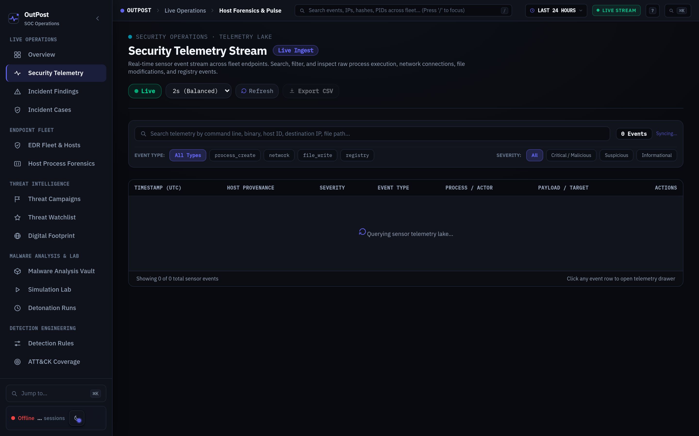
</p>

<details>
<summary><b>Host Forensics Sub-Views (Causality Tree, Network Matrix, Behavioral Insights)</b></summary>
<br>

#### Process Causality Tree
Hierarchical parent-child visualization linking parent PIDs, shell execution chains, and LOLBin invocations:
<p align="center">
  
</p>

#### Network Threat Matrix
4-domain classification dividing all live sockets into Public Listeners (`0.0.0.0`), Outbound C2/External endpoints, Loopback IPC, and Multicast channels:
<p align="center">
  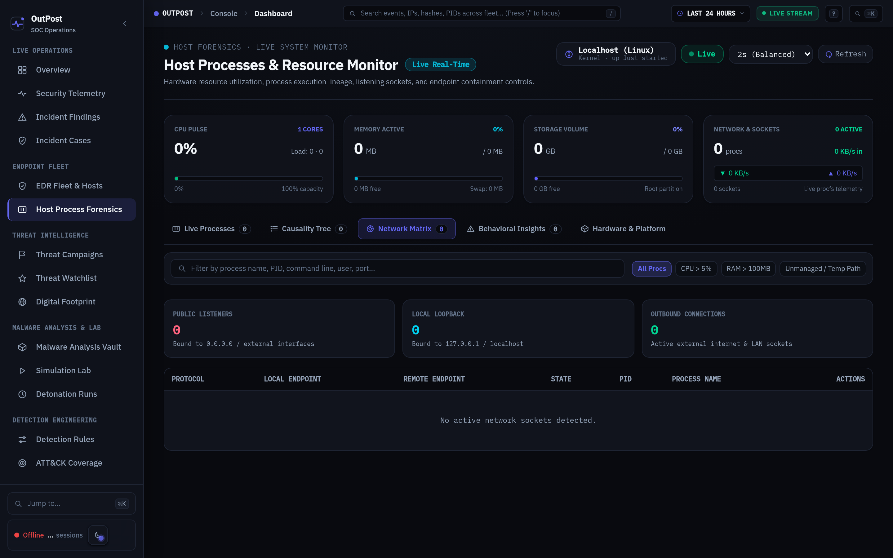
</p>

#### Behavioral Insights & Heuristics
Heuristic anomaly explanations highlighting dropped binaries in temporary folders, unmanaged processes, and elevated capabilities:
<p align="center">
  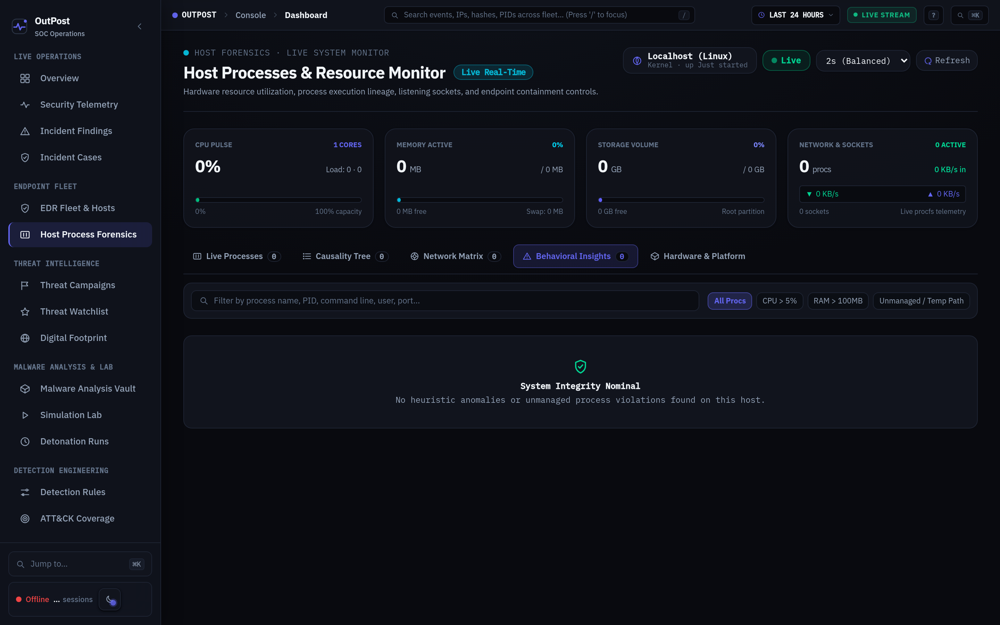
</p>

</details>

---

### 3. Incident Findings & Alert Queue (`/findings`)
Centralized SOC alert queue with MITRE ATT&CK technique tags, severity badges (`critical`, `malicious`, `suspicious`, `info`), 1-click false-positive suppression, and direct escalation to investigation cases.

<p align="center">
  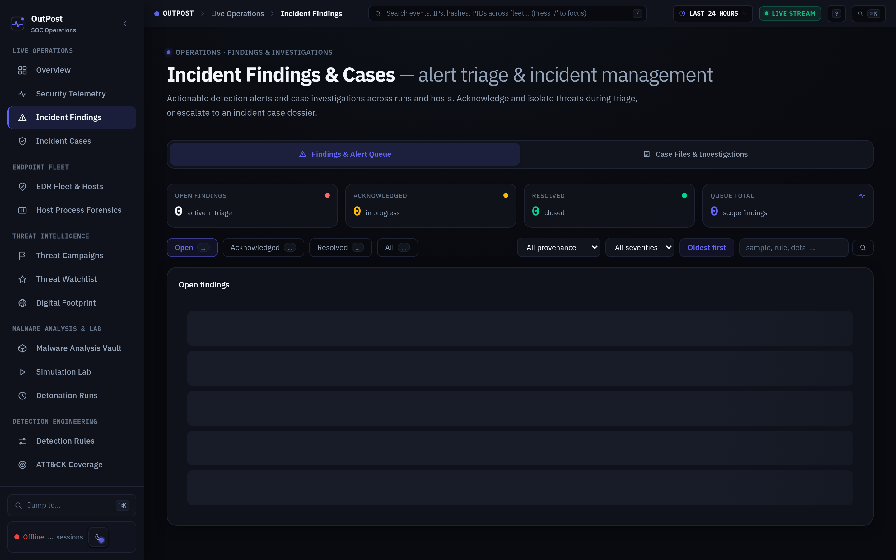
</p>

---

### 4. Endpoint Fleet & Sensor Management (`/agents` & `/hosts/local`)
Live endpoint agent tracking. Displays enrollment tokens, OS badges, collector health metrics, and deep per-host forensic breakdowns.

<p align="center">
  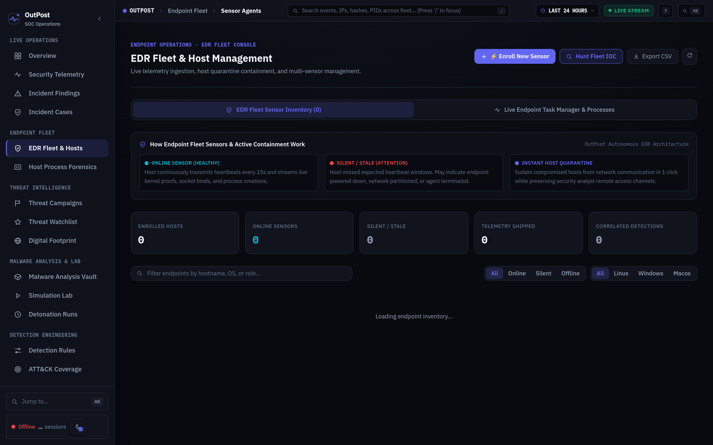
  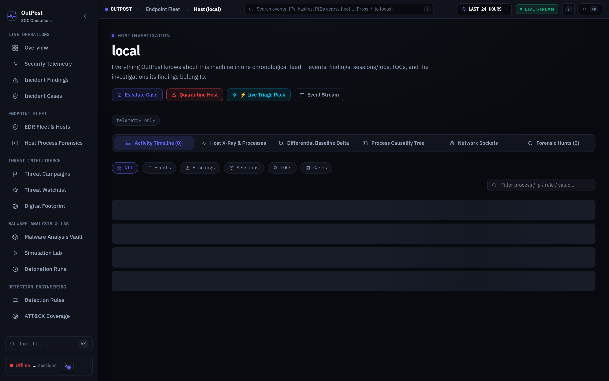
</p>

---

### 5. Incident Investigation Dossiers (`/investigations`)
Full lifecycle investigation workspace. Build forensic evidence collections, correlate cross-run event timelines, write collaborative analyst notes, and track statuses from `open` → `in_progress` → `closed`.

<p align="center">
  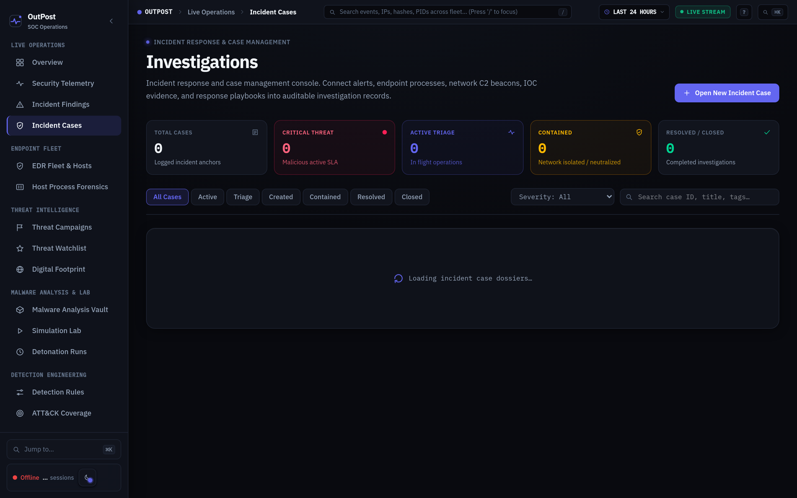
  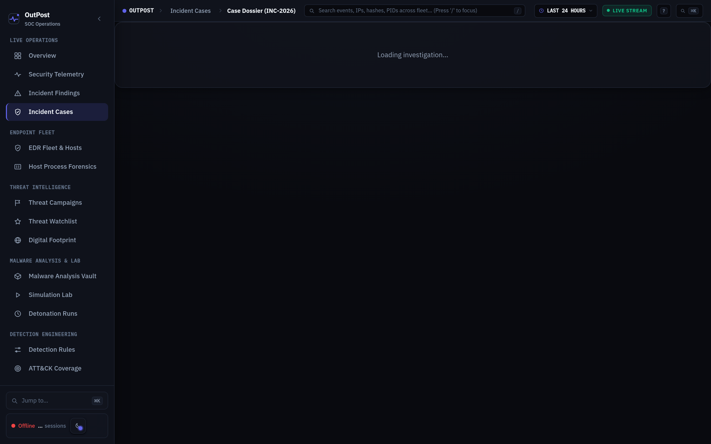
</p>

---

### 6. Malware Sample Vault & Multi-Format Static Analysis (`/samples`)
Secure artifact vault supporting drag-and-drop binary ingestion, SHA-256 fingerprinting, Shannon entropy analysis, multi-format structural inspection, family config decoders, and YARA signature matches.

<p align="center">
  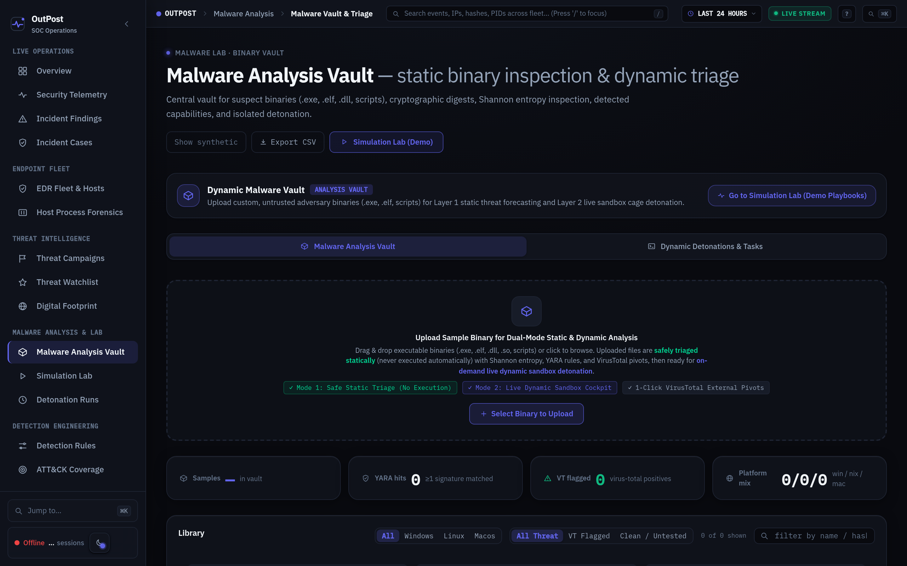
  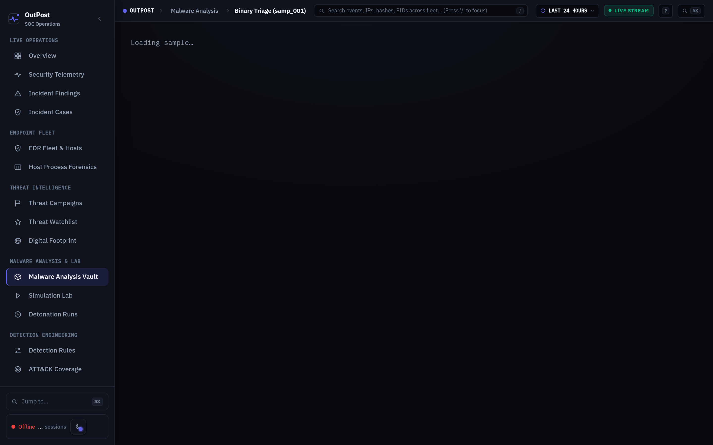
</p>

---

### 7. Adversary Attack Simulation Lab (`/monitor`)
Deterministic attack scenarios and vault executable detonations executed in real-time. Streams terminal stdout/stderr, displays process causality trees, and maps detection rule hits live during execution.

<p align="center">
  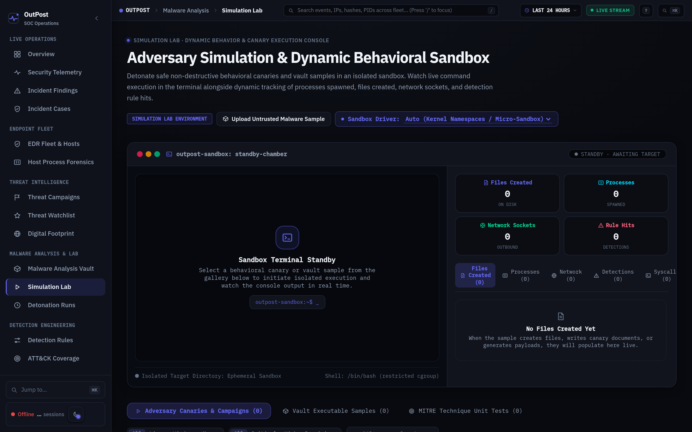
  
</p>

---

### 8. Detection Rules Studio (`/rules`)
Rule management and tuning studio. Inspect YAML rule definitions, adjust severity weights, configure suppression allowlists, and backtest against past telemetry:

<p align="center">
  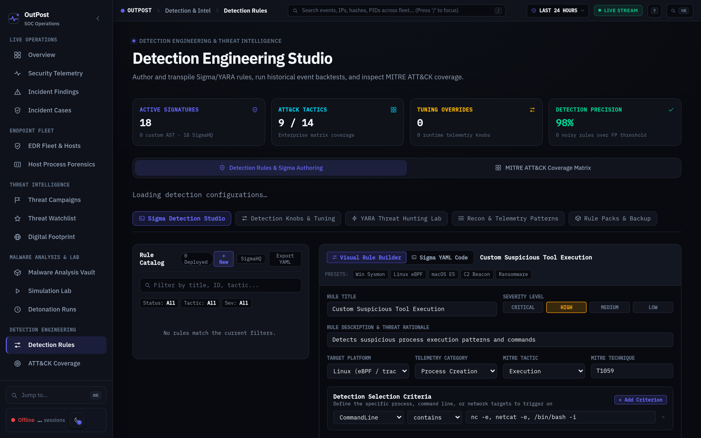
</p>

---

### 9. MITRE ATT&CK Matrix & Coverage Heatmap (`/coverage`)
Comprehensive tactical heatmap covering all 14 MITRE tactics with full Technique Matrix modal, rule weights, detection gaps, and layer export capabilities.

<p align="center">
  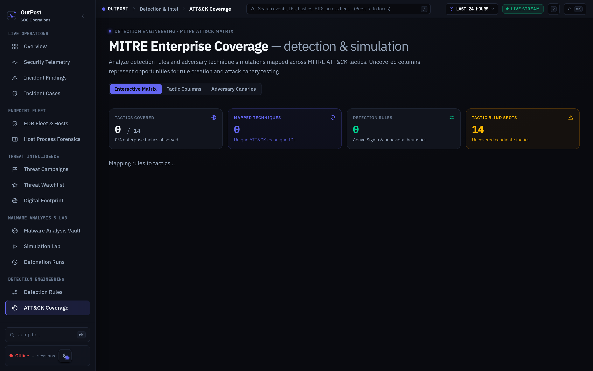
  
</p>

---

### 10. Global Search & Threat Watchlist (`/search`)
Cross-session search across IP addresses, domains, process names, and SHA-256 hashes, with a personal watchlist manager:

<p align="center">
  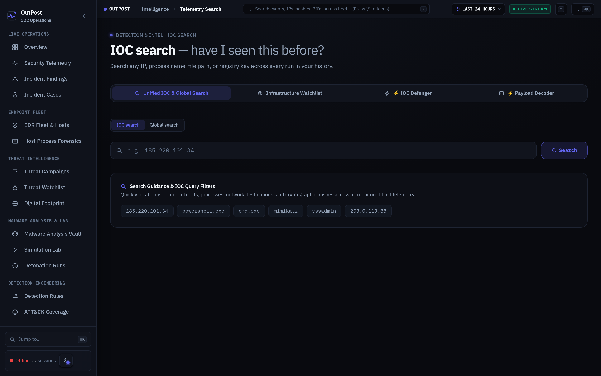
</p>

---

### 11. Tamper-Evident SHA-256 Audit Trail (`/audit`)
Cryptographically chained audit trail tracking all mutating operator and system actions (containment, process termination, rule creation/tuning, sample upload/deletion, detonations, token rotation, and exports):
- **Sequential Hash Chaining**: Every row calculates an immutable SHA-256 digest covering timestamp, actor, action, target, detail, outcome, source IP, before/after states, and commits to the previous entry's digest (`prev_hash`).
- **Database Engine Triggers**: SQLite engine triggers (`trg_audit_log_no_update` and `trg_audit_log_no_delete`) abort any direct SQL `UPDATE` or `DELETE` attempt at the database layer.
- **Signed Periodic Checkpoints**: Analysts can generate HMAC-signed checkpoints signed by a local private key (`data/audit_signing.key`) with separate public key verification.
- **Out-of-Band Checkpoint Export**: Exportable for external physical or cold-storage archiving to mitigate adversary database rewrites.
- **Active Verification**: The CLI (`outpost audit verify`), REST API (`GET /audit/verify`), and Web UI continuously compute chain integrity and pinpoint the first break (position, expected, found).

<p align="center">
  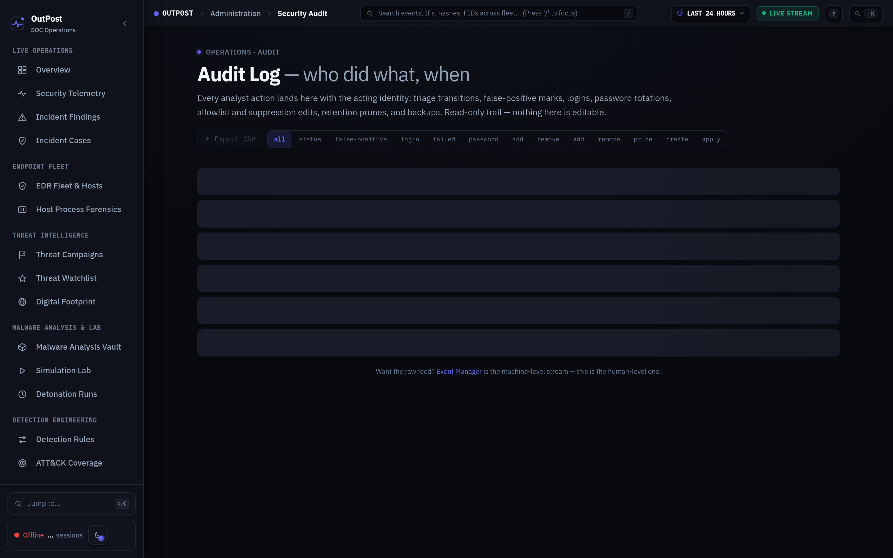
</p>

---

### 12. System Settings & Webhook Integrations (`/settings`)
Configure data retention windows, telemetry thresholds, and outbound webhook integrations (Slack, Discord, Microsoft Teams, Syslog):

<p align="center">
  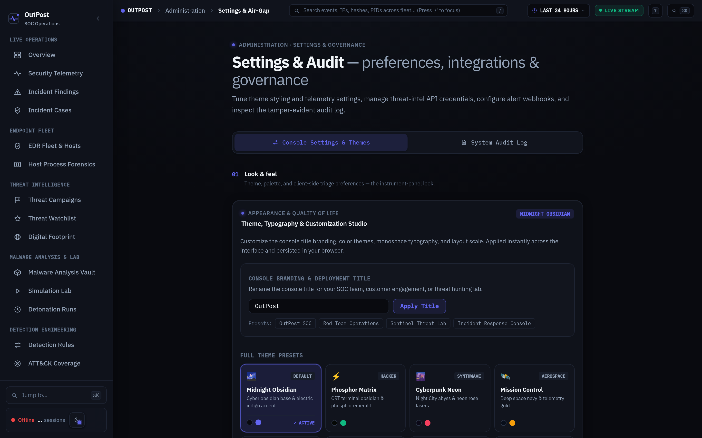
</p>

---

## CLI & Interactive SOC Terminal

OutPost includes a standalone CLI with **39 commands** across all 5 operational pillars, plus an interactive, full-screen Rich TUI console.

```bash
# Launch the interactive 5-Pillar SOC Terminal Console
./outpost.sh

# Background daemon operations
./outpost.sh start         # Start backend (:8001) & web console (:5174)
./outpost.sh status        # Real-time health diagnostic HUD of all platform components
./outpost.sh stop          # Gracefully stop all services

# Direct CLI commands
./outpost.sh watch         # Stream live host telemetry & detection alerts
./outpost.sh alerts        # View open SOC findings
./outpost.sh forensics snapshot # Capture complete forensic snapshot
./outpost.sh samples list  # List samples in the vault
./outpost.sh playbooks     # Execute automated IR playbooks & containment
./outpost.sh intel hunt    # Fleet-wide retrospective compromise hunt
```

### 5-Pillar SOC TUI Interactive Hotkeys

When running `./outpost.sh` in an interactive terminal, control the entire platform without exiting:

- **`[1]` - `[5]`**: Switch directly between Operational Pillars:
  - `[1]` **Live Operations** (`Host Forensics`, `Telemetry Radar`, `Findings Queue`)
  - `[2]` **Endpoint Fleet** (`Sensor Agents`, `Host Forensics & /proc audit`, `Containment`)
  - `[3]` **Malware & Lab** (`Simulation Lab`, `Detonation Runs`, `Dynamic Sandbox`)
  - `[4]` **Detection & Intel** (`MITRE ATT&CK Matrix`, `Threat Watchlist`, `Rules`)
  - `[5]` **Administration & Tools** (`Payload Decoder`, `IOC Workbench`, `Audit Trail`)
- **`[:]`**: Open universal **In-App Command Palette** to execute any Typer command
- **`[t]`**: Open interactive **Alert Triage Modal** (`acknowledge`, `resolve`, `reopen`)
- **`[c]`**: Interactively **Create Incident Investigation Case**
- **`[i]`**: Toggle **Host Containment / Network Isolation**
- **`[/]`**: Interactive IOC search across historical sessions and telemetry

---

## Installation & Quickstart

### Prerequisites

| Requirement | Supported Version |
|---|---|
| **Python** | 3.10, 3.11, 3.12, 3.13, 3.14 |
| **Node.js** | 18 or higher (Node 20+ recommended) |
| **Operating System** | Linux (Ubuntu, Debian, Fedora, Arch, RHEL), macOS, or Windows (WSL2 recommended) |

### Linux & macOS (Universal `./outpost.sh` Launcher)

```bash
# 1. Clone repository
git clone https://github.com/kripy17/OutPost.git
cd OutPost

# 2. Automated setup (creates Python venv, installs dependencies, builds frontend)
./setup.sh

# 3. Start background services and verify status
./outpost.sh start
./outpost.sh status
```

### Windows (PowerShell)

```powershell
# 1. Clone repository
git clone https://github.com/kripy17/OutPost.git
cd OutPost

# 2. Run automated installer
powershell -ExecutionPolicy Bypass -File scripts\install.ps1

# 3. Start OutPost stack
powershell -ExecutionPolicy Bypass -File scripts\dev.ps1 start
```

### Accessing OutPost

| Service | Access URL / Command | Description |
|---|---|---|
| **Web Console** | [http://localhost:5174](http://localhost:5174) | Full React 19 SOC Operations Cockpit |
| **API Documentation** | [http://localhost:8001/docs](http://localhost:8001/docs) | Interactive Swagger / OpenAPI documentation |
| **Interactive SOC TUI** | `./outpost.sh` | Full terminal console with hotkeys `[1]`–`[5]` |
| **CLI Help** | `./outpost.sh --help` | 39 commands across all operational pillars |

### Deploy Telemetry Agents to Remote Endpoints

To preserve forensic integrity and avoid piping untrusted network scripts into elevated shells, OutPost provides verified checksum manifests, dry-run inspection plans, and offline air-gapped packages:

**Linux & macOS (Verified Checksum & Dry-Run Flow):**
```bash
# 1. Fetch published checksums and installer artifact
curl -fsSL -O http://<OUTPOST_SERVER>:8001/agents/SHA256SUMS
curl -fsSL -O http://<OUTPOST_SERVER>:8001/agents/install.sh

# 2. Verify installer integrity against published SHA-256 digests
sha256sum -c SHA256SUMS --ignore-missing

# 3. Inspect planned changes before modifying system state
bash install.sh --dry-run

# 4. Execute installation with explicit server destination
sudo bash install.sh --server http://<OUTPOST_SERVER>:8001
```

**Windows (Administrator PowerShell):**
```powershell
# 1. Download installer script
Invoke-WebRequest -Uri http://<OUTPOST_SERVER>:8001/agents/install.ps1 -OutFile install.ps1

# 2. Inspect planned changes
.\install.ps1 -DryRun

# 3. Execute installation
.\install.ps1 -Server http://<OUTPOST_SERVER>:8001
```

**Air-Gapped / Isolated Enclaves:**
Download the offline sensor package directly from the OutPost console or via `GET /agents/package/offline`:
```bash
curl -fsSL -O http://<OUTPOST_SERVER>:8001/agents/package/offline
tar -xzf outpost-agent-offline.tar.gz && cd outpost-agent-offline && sudo ./install.sh --offline
```

---

## Architecture

```text
┌────────────────────┐    ┌────────────────────┐    ┌────────────────────┐
│   Linux Endpoint   │    │  Windows Endpoint  │    │   macOS Endpoint   │
│auditd/tracing_pipe │    │  Microsoft Sysmon  │    │  EndpointSecurity  │
│ collector_linux.py │    │  collector_win.py  │    │ collector_macos.py │
└─────────┬──────────┘    └─────────┬──────────┘    └─────────┬──────────┘
          │  POST /ingest/batch     │                         │
          └─────────────────────────┼─────────────────────────┘
                                    ▼
                    ┌───────────────────────────────┐
                    │     FastAPI Backend (:8001)    │
                    │  ┌──────────────────────────┐ │
                    │  │ Normalizer → Detection   │ │
                    │  │ Static Worker (RLIMITs)  │ │
                    │  │ Dynamic Sandbox (bwrap)  │ │
                    │  │ Process Tree & Evidence  │ │
                    │  └──────────────────────────┘ │
                    │       SQLite / PostgreSQL      │
                    └───────────────┬────────────────┘
                                    │ REST API & SSE
                    ┌───────────────┴────────────────┐
                    ▼                                ▼
        ┌──────────────────┐            ┌──────────────────┐
        │  React Web App   │            │  CLI & Rich TUI  │
        │  (:5174)         │            │  39 commands     │
        │  Vite + TS + TW  │            │  Typer + Rich    │
        └──────────────────┘            └──────────────────┘
```

### OS Compatibility & Confinement

- **Linux (Primary / Sandbox Isolation)**: Uses unprivileged user namespaces via Bubblewrap (`bwrap`) for dynamic sandbox confinement, dedicated resource-limited subprocesses (`RLIMIT_AS`, `RLIMIT_CPU`) for static parsing, and native `/proc` capability audits.
- **Windows**: Fleet monitoring via dedicated Sysmon collector (`collector_win.py`) mapping Event IDs 1, 3, 6, 7, 8, 10, 11, 12, 13, 14, 23. Cross-platform process lifecycle controls via `psutil`. For hosting the central stack, **WSL2** is recommended.
- **macOS**: Fleet monitoring via `collector_macos.py` parsing Apple EndpointSecurity & OpenBSM audit records, TCC database access detection, and LaunchDaemon persistence auditing. Network containment is unsupported on macOS.

---

## Security Validation Corpus & Test Suite

OutPost enforces automated test coverage across all subsystems, validated by a local benchmark corpus gate:

```bash
# Execute the full automated test suite
./.venv/bin/pytest backend collectors/tests cli/tests
npm --prefix frontend test -- --run
```

### Test Suite Breakdown

| Suite | Tests | Status |
|---|---|---|
| **Backend Test Suite** | **966** | Passing |
| **Collector Test Suite** | **55** | Passing |
| **CLI & TUI Test Suite** | **208** | Passing |
| **Frontend Test Suite** | **441** | Passing |
| **Total Automated Coverage** | **1,670** | **Passing** |

### Benchmark Corpus Gate Results

The automated regression gate (`test_validation_corpus_gate.py`) evaluates detection and false-positive performance against ground-truth samples:

```text
======================== OUTPOST VALIDATION BENCHMARK ========================
Total Samples Evaluated:     10
  - Benign System/Vendor:     5
  - Weaponized/Threat:        5

Results:
  False Positive Rate (FPR): 0.0%   (Expected: <= 0.0%) -> PASS
  Detection Rate (TPR):      100.0% (Expected: >= 90.0%) -> PASS
  Parser Crashes / Timeouts: 0      (Expected: 0)       -> PASS
==============================================================================
```

---

## Documentation

Comprehensive technical documentation is maintained in [`docs/`](docs/):

| Specification | Description |
|---|---|
| [`01-ARCHITECTURE.md`](docs/01-ARCHITECTURE.md) | Platform architecture, component boundaries, and pipeline flow |
| [`02-BACKEND-SPEC.md`](docs/02-BACKEND-SPEC.md) | FastAPI endpoint contracts, Pydantic schemas, and database models |
| [`03-COLLECTOR-SPEC.md`](docs/03-COLLECTOR-SPEC.md) | Multi-OS agent specifications (Linux, Windows Sysmon, macOS) |
| [`04-FRONTEND-SPEC.md`](docs/04-FRONTEND-SPEC.md) | Web application routing, state stores, and component hierarchy |
| [`05-DEPLOYMENT-SETUP.md`](docs/05-DEPLOYMENT-SETUP.md) | Production setup, systemd services, and air-gap verification |
| [`09-CLI-SPEC.md`](docs/09-CLI-SPEC.md) | Full 39-command Typer CLI reference manual |
| [`11-DETECTION-LOGIC.md`](docs/11-DETECTION-LOGIC.md) | MITRE ATT&CK detection heuristics with detection engineering rationale |
| [`16-POSTGRES-MIGRATION.md`](docs/16-POSTGRES-MIGRATION.md) | PostgreSQL production migration procedures and data load scripts |
| [`17-CI-GATES.md`](docs/17-CI-GATES.md) | Continuous integration regression gates and benchmark guarantees |
| [`18-AIR-GAP.md`](docs/18-AIR-GAP.md) | Air-gap compliance testing and offline guarantees |
| [`19-PRODUCT-COHERENCE-SPEC.md`](docs/19-PRODUCT-COHERENCE-SPEC.md) | SOC transformation, provenance contracts, and UX standards |
| [`20-THREAT-MODEL.md`](docs/20-THREAT-MODEL.md) | Formal threat model: assets, threat actors, trust boundaries & automated controls |
| [`SECURITY.md`](SECURITY.md) | Security vulnerability disclosure policy and malware safe-handling guidance |

### Architecture Decision Records (ADRs)

Engineering rationale, alternatives rejected, and operational trade-offs are maintained in [`docs/adr/`](docs/adr/):

- [ADR 0001: Single-Node Architecture Design](docs/adr/0001-single-node-design.md)
- [ADR 0002: Dual SQLite and PostgreSQL Storage Engine Support](docs/adr/0002-sqlite-and-postgres-support.md)
- [ADR 0003: Pull-Based Agent Control and Ingest Channel](docs/adr/0003-pull-based-control-channel.md)
- [ADR 0004: In-Process Synchronous vs. Worker Detection Pipeline](docs/adr/0004-in-process-vs-worker-detection.md)
- [ADR 0005: Sandbox Design via Bubblewrap (bwrap) and Wine Isolation](docs/adr/0005-bubblewrap-and-bwrap-sandbox-design.md)

---

## License

Distributed under the [MIT License](LICENSE).

<div align="center">

**Created by [Krish Patel](https://github.com/kripy17)**

</div>
