# OutPost — Malware Analysis Workbench & Behavioral Security Monitor

[](https://github.com/kripy17/OutPost/actions)
[](docs/11-DETECTION-LOGIC.md)
[](docs/11-DETECTION-LOGIC.md)
[](docs/09-CLI-SPEC.md)
[](backend/README.md)
[](frontend/README.md)
[](docs/18-AIR-GAP.md)
[](LICENSE)

**OutPost** is an offline-first, dual-layer **Static and Dynamic Malware Analysis Workbench & Behavioral Threat Forecaster** engineered for malware analysts, reverse engineers, incident responders, and detection teams.

Designed from the ground up for air-gapped lab networks and forensic environments, OutPost delivers rapid binary triage, automated Remote Access Trojan (RAT) configuration extraction, zero-execution Layer-1 behavioral threat forecasting, bubblewrap-isolated dynamic detonation, interactive parent-child process causality trees, and Sigma-powered MITRE ATT&CK® detection engineering—**without requiring external cloud telemetry or third-party API keys**.

---

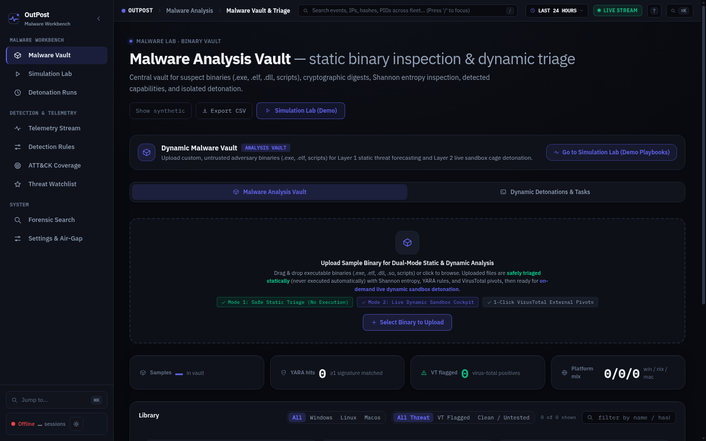

---

## Key Highlights & Architectural Capabilities

### 1. Dual-Layer Analysis Methodology
- **Layer 1: Pre-Execution Threat Forecaster**: Predicts potential C2 endpoints, file/registry persistence footholds, and MITRE ATT&CK techniques heuristically *before* binary execution, eliminating blind detonations.
- **Layer 2: Isolated Dynamic Detonation (Bubblewrap)**: Safely executes suspicious Linux binaries and scripts inside unprivileged user namespaces (`bwrap`) with read-only root mounts, loopback-only networking, and full capability drops (`--cap-drop ALL`), capturing every system call via high-resolution `strace`.

### 2. Deep Static Analysis & Fuzzy Clustering
- **Multi-Format Static Dossier**: Forensic inspection of Portable Executable (PE32/PE64), Executable and Linkable Format (ELF32/ELF64), Mach-O, scripts (PowerShell, Bash, Python, PHP), and multi-layer compressed archives (Zip, Tar, Gzip).
- **Cryptographic & Similarity Hashes**: Calculates MD5, SHA-1, SHA-256, ImpHash, SSDEEP, and TLSH (Trend Micro Locality Sensitive Hash) for cluster detection across polymorphic malware variants.
- **PE Section Entropy Visualizer**: Visualizes section entropy to instantly flag packed or encrypted payloads (`UPX`, `Themida`, custom crypters).

### 3. Automated RAT Configuration Decoders
- OutPost incorporates zero-touch configuration extractors for high-impact threat families:
  - **Remcos RAT**: In-memory decryption of RC4-encrypted resource blocks containing C2 addresses, fallback ports, campaign IDs, and mutex names.
  - **AsyncRAT**: Decryption of AES-256-CBC encrypted .NET settings and certificate fingerprints.
  - **RedLine Stealer**: Extraction of base64/XOR-encoded C2 communication strings and token targets.
  - **Cobalt Strike**: Extraction of embedded Beacon configuration blocks (watermark, sleep time, jitter, C2 URLs).

### 4. Interactive Process Causality Tree (DAG)
- Reconstructs execution timelines into interactive parent-child lineage graphs.
- Displays PID/PPID hierarchy, command-line arguments, process start/exit timestamps, return codes, and chronological syscall events.

### 5. Detection Rules Studio & MITRE ATT&CK® Heatmap
- Author, test, simulate, and backtest behavioral detection rules using Sigma and custom YAML definitions.
- Visualizes enterprise threat coverage across all 14 MITRE ATT&CK tactics (100% matrix coverage with 48 built-in behavioral rules).

### 6. Air-Gap First Architecture & SSRF Guard
- Fully self-contained with zero telemetry pings or external API requirements.
- Multi-channel notification pipeline (Slack, Discord, Telegram, Webhook) hardened with strict Server-Side Request Forgery (SSRF) validation gates.

---

## 60-Second Quickstart

### Option A: One-Command Turnkey Launcher (Recommended)

OutPost provides an automated launcher that verifies virtual environments, builds frontend assets, seeds demo malware samples, and starts services:

```bash
# Clone the repository
git clone https://github.com/kripy17/OutPost.git
cd OutPost

# Start the full stack with demo malware samples and telemetry pre-seeded
./start.sh --demo
```

- **Analyst Web UI**: Navigate to **`http://localhost:5174`**
- **FastAPI REST API & OpenAPI Docs**: Navigate to **`http://localhost:8001/docs`**

To launch without seeding demo data:
```bash
./start.sh
```

### Option B: Docker Compose

Deploy the complete isolated stack in containers:

```bash
docker-compose up -d
```

### Option C: Manual Setup

<details>
<summary>Click to view manual step-by-step setup</summary>

#### 1. Backend Setup
```bash
# Create and activate Python 3.12+ virtual environment
python3 -m venv .venv
source .venv/bin/activate

# Install backend dependencies in editable mode
pip install -e backend[dev]

# Seed demo threat data (optional)
python -m app.seed_demo

# Start the FastAPI server
python -m uvicorn app.main:app --host 127.0.0.1 --port 8001 --reload
```

#### 2. Frontend Setup
```bash
cd frontend
npm install
npm run dev -- --port 5174
```

#### 3. CLI Setup
```bash
# Install the outpost CLI in your virtual environment
pip install -e cli
```
</details>

---

## Ground-Truth Behavioral Verification Suite

To guarantee 100% telemetry fidelity and zero false positives, OutPost is benchmarked against compiled ground-truth probes executed inside the Bubblewrap sandbox. Every captured syscall sequence is validated against known-truth specifications.

| Probe Binary | Source & Architecture | Syscalls Traced | Captured Ground-Truth Actions | Containment Verification |
| :--- | :--- | :--- | :--- | :--- |
| **`probe_elf`** | C / ELF 64-bit LSB PIE (`gcc -O2`) | 1,094 lines | File creation (`fd 10`), payload write (`34 bytes`), `chmod 0600`, clean exit | Unprivileged namespace, zero host leakage |
| **`probe.sh`** | Bash Shell Script | 2,841 lines | File redirection (`fd 1`), `mv`, `rm`, child process spawn, DNS query attempt, socket connect attempt (`ENETUNREACH`) | Air-gap verified: network unshared, ICMP blocked |
| **`probe.py`** | Python 3 Script (CPython) | 3,061 lines | File creation, write, rename, unlink, subprocess execution, DNS resolution retry cycle, TCP connect attempt | Private `/tmp`, read-only root mounts |
| **Benign Baseline** | `/bin/ls`, `/bin/grep`, `/bin/whoami`, `curl` | N/A | Normal system execution | **0 False Positives** across all 48 detection rules |

> Detailed probe execution specifications and hashes are documented in [`tests/fixtures/probe_run_metadata.txt`](tests/fixtures/probe_run_metadata.txt).

---

## Analyst Workspaces Tour

OutPost provides 11 dedicated, responsive workspaces designed for specialized threat investigation workflows:

### 1. Malware Vault & Catalog (`/samples`)
Multi-format repository of ingested malware binaries, malicious documents, and suspicious scripts. Filter and sort by threat family, architecture, platform, risk score, and submission timestamp.


---

### 2. Deep Static Dossier & Layer-1 Forecast (`/samples/:id`)
Comprehensive forensic inspection displaying cryptographic hashes, TLSH clustering, PE section entropy, string categorization, YARA rule hits, extracted RAT configuration parameters, and Layer-1 pre-execution behavioral predictions.

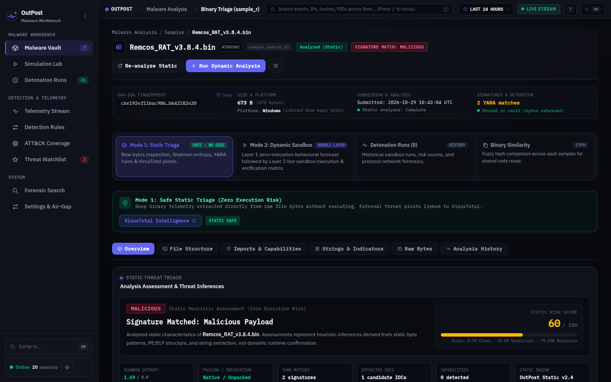

---

### 3. Simulation Lab & Probe Launcher (`/monitor`)
Interactive environment to test detection rules, execute ground-truth behavioral probes, and verify sandbox containment.

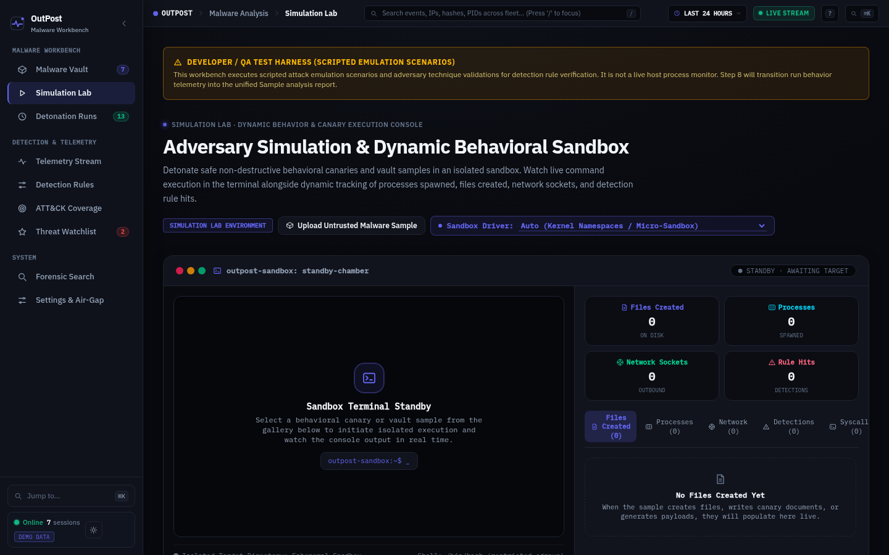

---

### 4. Dynamic Detonation Runs (`/analysis`)
Historical ledger of all containerized sandbox detonations, tracking run status, duration, process counts, syscall volume, and detected MITRE techniques.

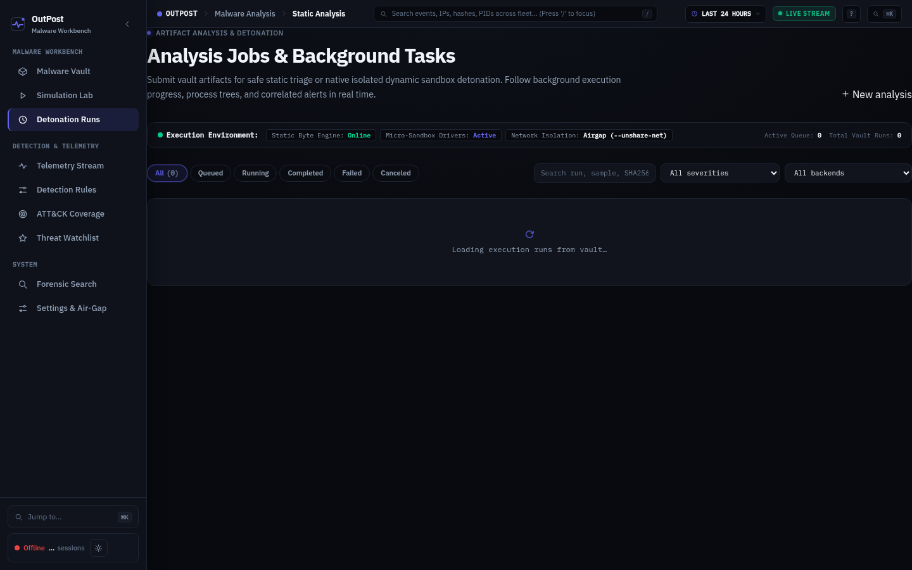

---

### 5. Run Dossier & Process Causality Tree (`/runs/:id`)
Deep forensic view of an individual dynamic detonation. Features an interactive parent-child process causality DAG, network socket destinations with geo-enrichment, file system modifications, and alert timelines.

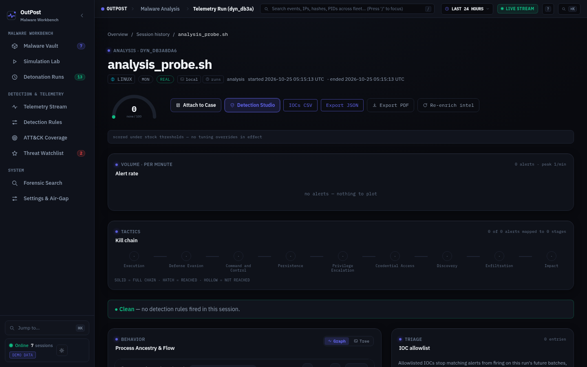

---

### 6. Real-Time Telemetry Stream (`/events`)
Live streaming endpoint telemetry viewer with facet filters (host, process, event type), timestamp scrubbing, and raw event JSON inspection.

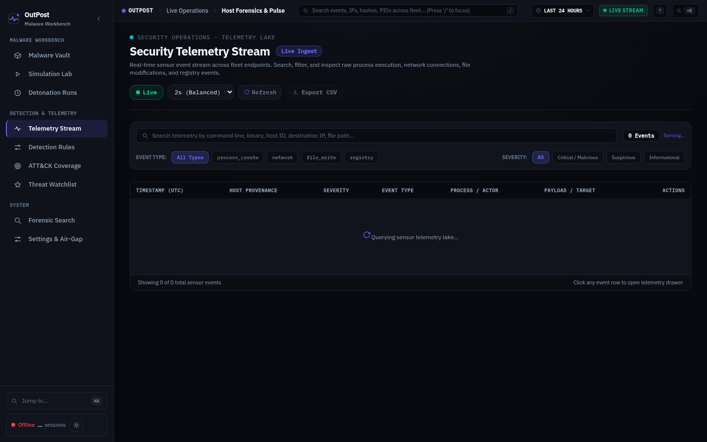

---

### 7. Detection Rules Studio (`/rules`)
Rule authoring workbench supporting Sigma and custom behavioral YAML rules. Includes real-time syntax checking, telemetry backtesting, and false-positive tuning knobs.

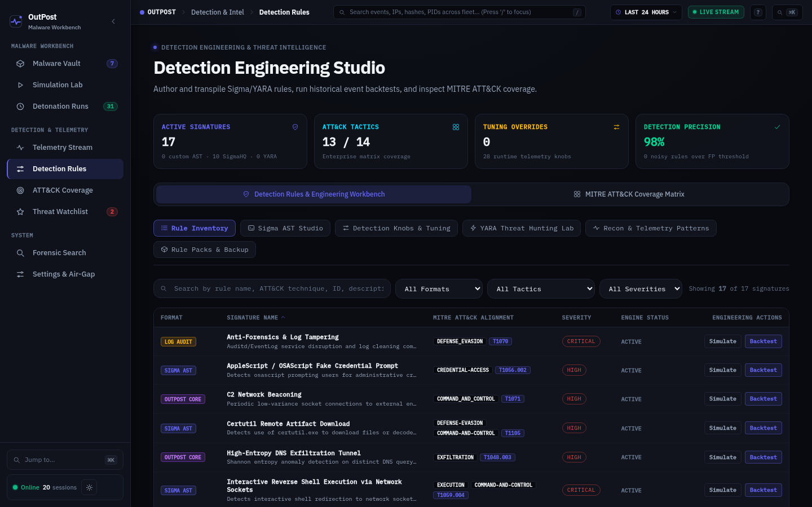

---

### 8. Enterprise ATT&CK Matrix Coverage (`/coverage`)
Interactive heatmap displaying detection coverage across all 14 Enterprise MITRE ATT&CK tactics, highlighting gaps and rule density.

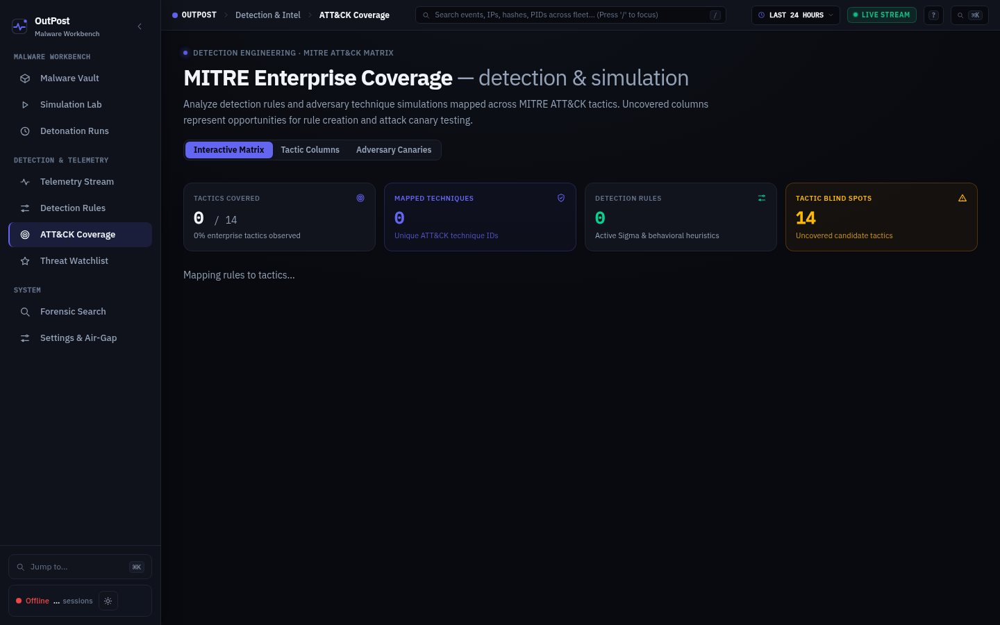

---

### 9. High-Priority Threat Watchlist (`/watchlist`)
Pin high-severity indicators of compromise (C2 IPs, domains, SHA-256 hashes) to trigger instant alerts upon subsequent sightings across the fleet or sandbox.

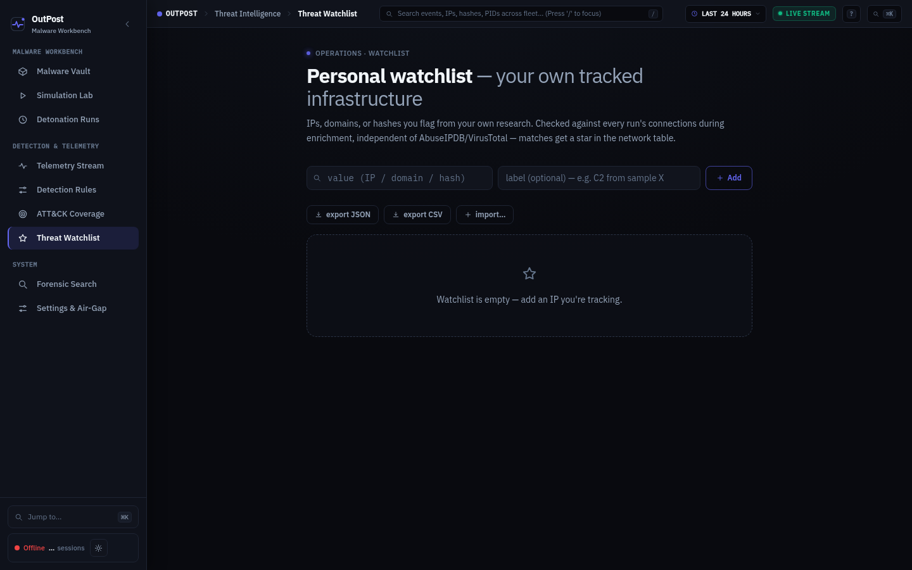

---

### 10. Universal IOC Search (`/search`)
Sub-millisecond global search across all samples, detonation artifacts, process commands, IP addresses, domains, and alert rules.

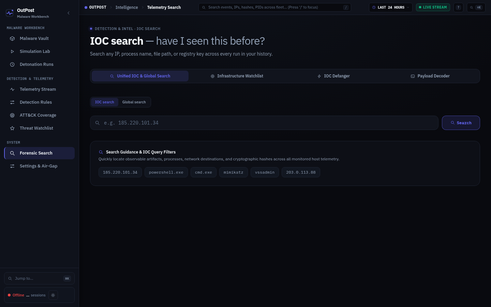

---

### 11. Air-Gap Governance & Alert Settings (`/settings`)
Configure multi-channel outbound alert integrations (Slack, Discord, Telegram, generic Webhook) with strict SSRF validation, audit logging, and SQLite database retention policies.

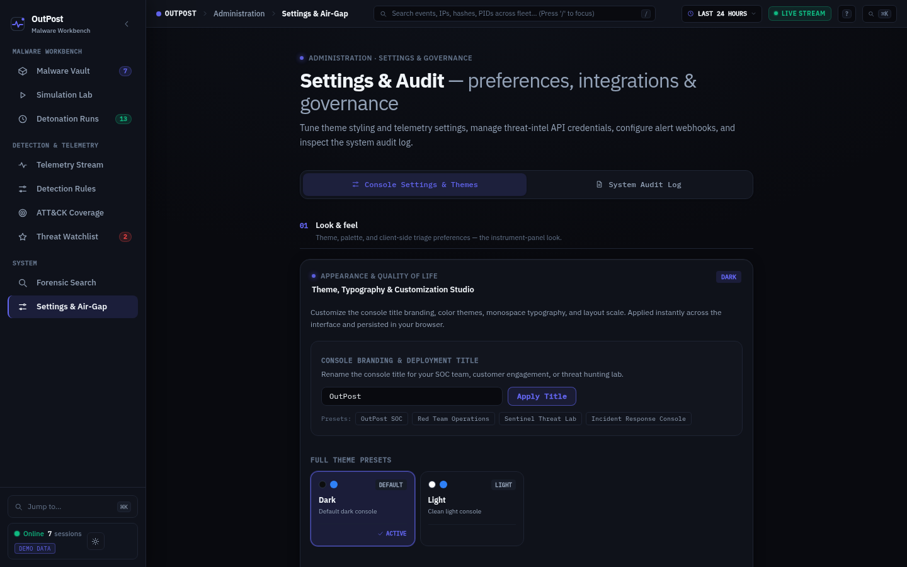

---

## OutPost Command-Line Interface (CLI)

The `outpost` CLI provides analysts with full terminal control over static analysis, configuration decoding, sandbox execution, and rule testing:

```bash
# 1. Run offline static analysis on a sample
./cli.sh scan ./malware_sample.exe

# 2. Extract and decrypt embedded RAT configurations (Remcos, AsyncRAT, RedLine, Cobalt Strike)
./cli.sh decode ./suspect_binary.exe

# 3. Detonate safely inside the local bubblewrap sandbox with strace
./cli.sh detonate ./malicious_script.sh --timeout 30

# 4. Search across all stored IOCs, samples, and runs
./cli.sh search 89.208.107.165

# 5. List and validate active detection rules
./cli.sh rules list

# 6. Launch the interactive Rich terminal UI (TUI)
./cli.sh tui
```

---

## Architecture & Security Boundary

```
                                  AIR-GAP BOUNDARY (NO EXTERNAL EGRESS)
 ┌────────────────────────────────────────────────────────────────────────────────────────┐
 │                                                                                        │
 │  ┌─────────────────────┐       ┌──────────────────────┐       ┌─────────────────────┐  │
 │  │   Analyst Browser   │ <───> │ React 18 / Vite SPA  │ <───> │  FastAPI REST API   │  │
 │  │ (Forensic Dark UI)  │       │ (Port 5174 / dist)   │       │     (Port 8001)     │  │
 │  └─────────────────────┘       └──────────────────────┘       └──────────┬──────────┘  │
 │                                                                          │             │
 │                                                  ┌───────────────────────┴──────────┐  │
 │                                                  │                                  │  │
 │                                        ┌─────────▼────────┐               ┌─────────▼────────┐
 │                                        │ Static Analysis  │               │ Dynamic Sandbox  │
 │                                        │ - PE / ELF / Zip │               │ - Bubblewrap     │
 │                                        │ - RAT Decoders   │               │ - strace parser  │
 │                                        │ - TLSH / Entropy │               │ - Process Tree   │
 │                                        │ - Layer-1 Pre-Fx │               │ - Net Intercept  │
 │                                        └─────────┬────────┘               └─────────┬────────┘
 │                                                  │                                  │  │
 │                                                  └───────────────────────┬──────────┘  │
 │                                                                          │             │
 │                                                                ┌─────────▼──────────┐  │
 │                                                                │ SQLite WAL Backend │  │
 │                                                                │  (Zero Ext. DBs)   │  │
 │                                                                └────────────────────┘  │
 └────────────────────────────────────────────────────────────────────────────────────────┘
```

### Multi-Ring Containment Model
1. **Lab VM Boundary**: Primary containment layer designed to run within a dedicated Linux forensic VM (QEMU/KVM, VMware, VirtualBox).
2. **Bubblewrap (`bwrap`) Isolation**: Unprivileged user namespaces (`--unshare-pid --unshare-net --unshare-ipc --unshare-uts`), read-only system binds (`/usr`, `/lib`), ephemeral private `/tmp`, and full capability stripping (`--cap-drop ALL`).
3. **Host Safety Guard (Dev-Probe Mode)**: Outside virtual machine environments, dynamic execution enforces cryptographic hash verification against sanctioned test probes before launch.
4. **Zero-Egress CI Gate**: Automated static AST analysis ([`scripts/gate_backend_egress.py`](scripts/gate_backend_egress.py)) continuously audits the codebase to guarantee that no outbound HTTP requests or cloud dependencies are introduced.

---

## Testing & Quality Assurance

OutPost enforces strict quality gates across backend engines, CLI tools, and frontend workspaces:

| Component | Test Engine | Scope | Passing Count |
| :--- | :--- | :--- | :--- |
| **Backend API & Parsers** | Pytest | Static parsers, RAT decoders, strace engine, auth | **812 passed** (1 skipped) |
| **CLI & TUI** | Pytest | Scanning, decoding, sandboxing, Rich rendering | **108 passed** |
| **Frontend Workspaces** | Vitest | React 18 components, state hooks, ARIA accessibility | **436 passed** (57 suites) |
| **Total Test Suite** | Automated | Cross-engine unit, integration, and regression suite | **1,249 passed** |
| **Air-Gap Egress Gate** | AST Audit | Egress compliance verification across 94 source files | **0 violations** |

Run the full verification sweep with a single command:
```bash
./verify.sh
```

---

## Subdirectory Documentation Index

- [Backend Documentation (`backend/README.md`)](backend/README.md) — FastAPI routing, static parsers, RAT decoders, bubblewrap sandbox, and pytest guides.
- [Frontend Documentation (`frontend/README.md`)](frontend/README.md) — React 18 architecture, workspace routing, Tailwind tokens, and Vitest suite.
- [CLI Reference (`cli/README.md`)](cli/README.md) — Command-line syntax, arguments, decoding commands, and interactive TUI guide.
- [Specifications & Specs (`docs/README.md`)](docs/README.md) — Technical specifications, ADRs, threat models, and lab VM setup instructions.
- [Scripts & Quality Gates (`scripts/README.md`)](scripts/README.md) — Screenshot capture tools, CI egress gates, and verification scripts.

---

## Author & Maintainer

- **Krish Patel** ([@kripy17](https://github.com/kripy17)) — Sole Author, Architect & Maintainer

---

## License

OutPost is open-source software licensed under the [MIT License](LICENSE).
